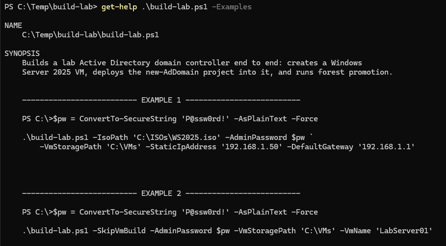
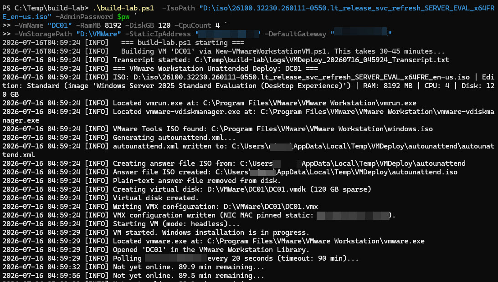
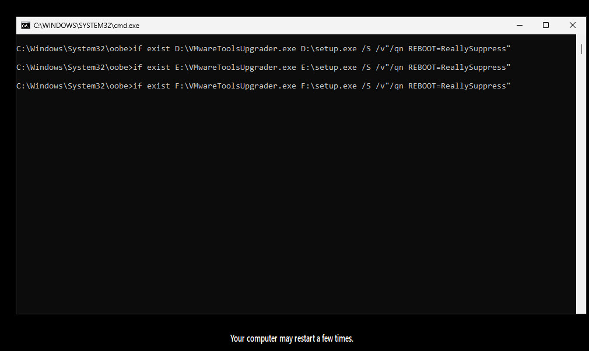
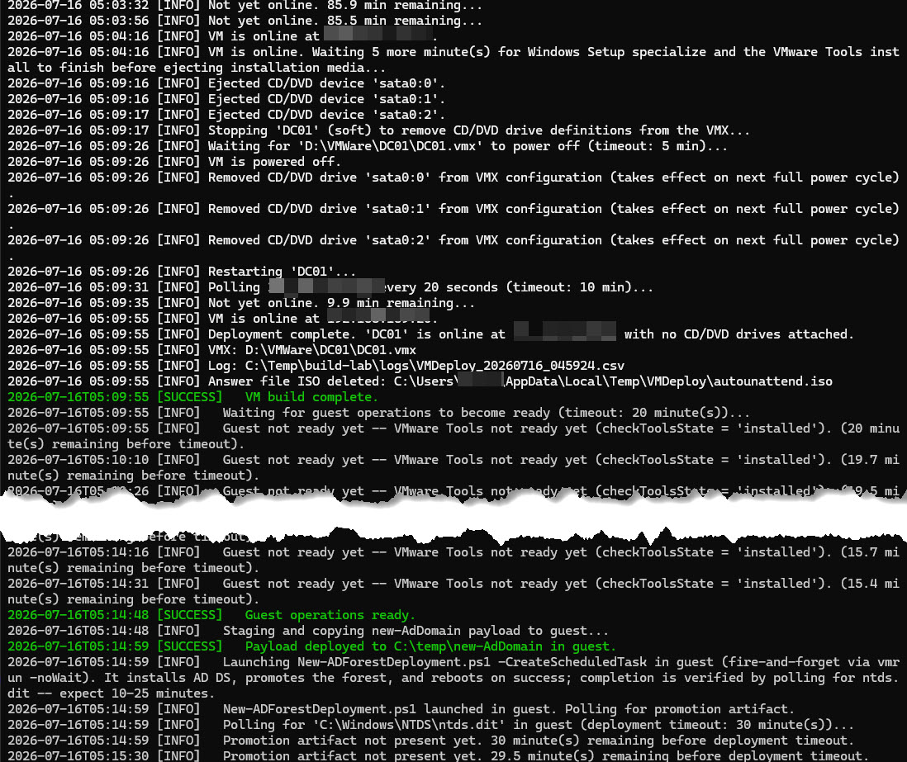
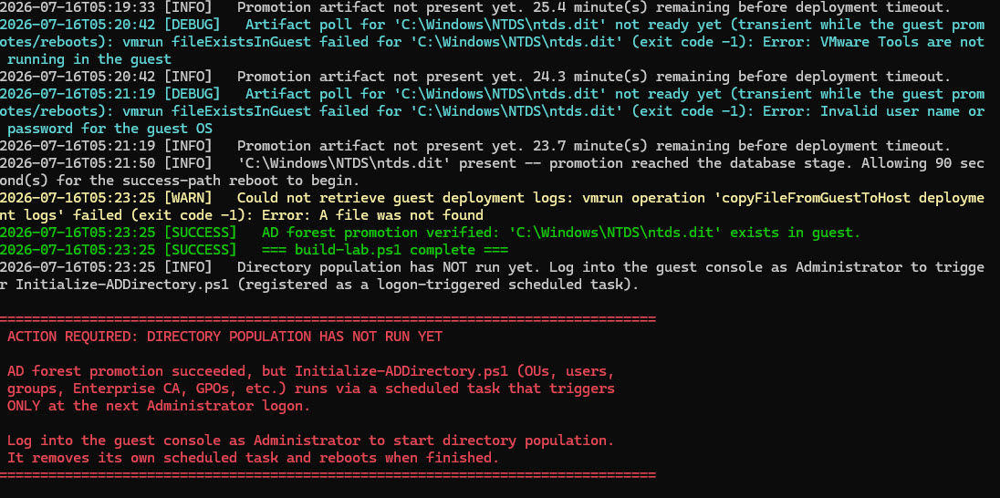
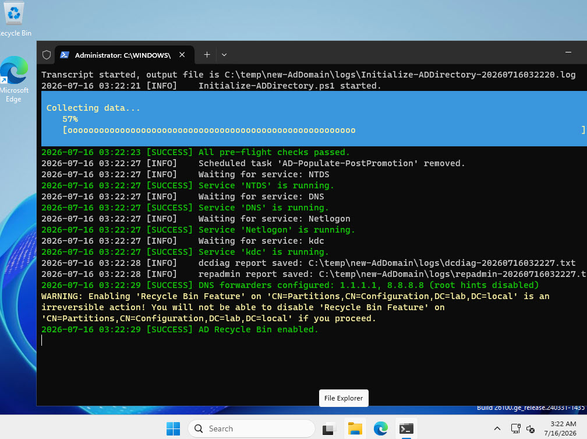

# build-lab

[](LICENSE)
[](https://learn.microsoft.com/powershell/)
[](https://www.microsoft.com/windows)
[](https://www.vmware.com/products/workstation-pro.html)

Stands up a lab Active Directory domain controller from an ISO in one command. It builds the Windows Server 2025 VM, promotes the forest, and stages a lived-in AD domain that populates itself at your first Administrator logon. Ask for member servers and it builds those too and joins them to the new domain, in the same run or later against the DC you already have.

I designed this because I like a fresh lab environment, but I do not like building a lab for the umpteenth time when the lab build may take more time than what I wanted to test.

## Why?

There are plenty of ways to deploy a Windows Server VM. There are plenty of scripts that promote an AD forest. There are even a few scripts that will give you that "lived in" feel.

What I could not find was one command that goes the whole way, ISO to a domain with objects in it, never opens a GUI, still leaves enough of a log trail to tell you why the script broke on the day it breaks, and requires exactly zero tooling outside of what Microsoft and VMware ship as part of the OS and hypervisor. So I wrote one.

## What It Does

`build-lab.ps1` is an orchestrator. It does not build a VM or promote a forest itself. It drives two sibling projects and stitches them together so one command takes you from an ISO to a promoted domain controller. Specifically:

1. Calls `New-VMwareWorkstationVM.ps1` to create and start a Windows Server 2025 VM with the CPU, RAM, disk, and static network settings you pass in.
2. Zips the `new-AdDomain` project on the host and pushes it into the guest at `C:\temp\new-AdDomain` over vmrun VIX guest operations, then verifies the payload landed.
3. Launches `New-ADForestDeployment.ps1 -CreateScheduledTask` inside the guest to install AD DS and promote the forest.
4. If you asked for member servers, builds them one at a time with the same VM builder (`SRVR-01`, `SRVR-02`, and so on) and joins each one to the new domain as a plain member.

```text
build-lab.ps1
      │
      ▼
New-VMwareWorkstationVM.ps1 ──► Windows Server 2025 VM
      │
      ▼
new-AdDomain payload ────────► C:\temp\new-AdDomain in the guest
      │
      ▼
New-ADForestDeployment.ps1 ──► forest promoted, verified by ntds.dit, a reboot, and the DC role
      │
      ├──► optional: SRVR-01..NN built and joined to the domain
      │
      ▼
scheduled task, waiting on your Administrator logon
      │
      ▼
Initialize-ADDirectory.ps1 ──► a domain with things in it
```

Here is the part that trips people up, so read it before you run anything.

Successful AD promotion immediately reboots Windows, which tears down the vmrun guest-operations channel mid-call. A blocking call hung on that reboot and never came back, so the guest script is launched fire-and-forget. That means there is no exit code to read at all, not even an untrustworthy one. So build-lab checks what it can see from the outside, in order. `C:\Windows\NTDS\ntds.dit` has to appear. Then the DC has to reboot, which build-lab detects with a registry key it plants just before the launch. Only a restart can remove it. Then the rebooted guest has to report itself as a domain controller in the domain you configured. Miss any of those and the run fails. The guest's own deployment logs are pulled back either way, so you can read why.

And one thing requires a tiny bit of your effort. Creating OUs, users, groups, the Enterprise CA, and GPOs is `Initialize-ADDirectory.ps1`'s job, and that runs from a scheduled task triggered at the next Administrator logon. I know it's unreasonable, but I need you to log in at least once. Build-lab cannot log in for you. When it finishes it prints a red banner reminding you to log into the guest console as Administrator to kick that off. The task keeps waiting either way, so nothing is lost if you miss the banner. You just get to stare at an empty domain first, wondering where all your objects went until you log in to debug and suddenly things start populating.

## Features

- One command takes you from an ISO to a promoted domain controller. No GUI, no answer-file editing, no clicking Next.
- Promotion is confirmed by evidence from the guest, not by trusting a process that reboots out from under you. `ntds.dit` has to be on disk, the DC has to reboot, and it has to come back as a domain controller in the right domain.
- Member servers on request. `-MemberServerCount` builds and joins them after the DC is verified, and `-AddMemberServers` adds more to a DC you already have without touching the DC.
- `-MoveMemberServers` files those members into `OU=Servers` once directory population has created it.
- Every static address is pinged before a VM gets it, so you do not end up with two machines fighting over one IP.
- Directory population is staged and waiting, so the domain fills itself in the moment you log on.
- The orchestrator's logs, the VM builder's, and the guest's own all land in one folder.
- Key events go to the Windows Application event log, if you want a SIEM to see this.
- `-SkipVmBuild` re-runs just the guest phases against a VM you already built and have not promoted yet.

## What's Changed Since 1.0

1.0 built one domain controller. The current version still does that, the same way, and adds member servers plus a fair amount of hardening that came out of reviews and live runs.

### New

- **Member servers.** `-MemberServerCount` builds `SRVR-NN` member servers after the DC's promotion is verified and joins them to the domain. They have their own size parameters. See [Member Servers](#member-servers).
- **`-AddMemberServers`.** Adds member servers to an existing DC. The DC is checked, never changed.
- **`-MoveMemberServers`.** Moves the members from `CN=Computers` to `OU=Servers` after directory population has run.
- **A ping before every static address.** The DC's address and every member address are pinged before use and refused if anything answers.
- **The version is in the log.** The first log line names the script version (`=== build-lab.ps1 <version> starting ===`), so a log always says what produced it.

### Changed behavior (read this if you used 1.0)

- **An unverified promotion now fails the run.** 1.0 polled for `ntds.dit`, waited a fixed grace period, and reported success. Now the DC also has to reboot and come back as a domain controller in the expected domain, or the run exits with code 1 and says which check failed.
- **Addresses are checked up front.** On `-NetworkType nat`, a `-StaticIpAddress` outside `net.3` to `net.127` is refused before anything is built. So are the network or broadcast address of the subnet, a gateway outside the DC's subnet or equal to the DC's address, and a `0.0.0.0` subnet mask.
- **`-SkipVmBuild` refuses a promoted DC.** On a working DC it could only delete the deployment logs and then fail, so it now stops before changing anything. It also cannot be combined with member servers. That is what `-AddMemberServers` is for.
- **Windows PowerShell 5.1 (Desktop) is enforced** with `#Requires`. 1.0 targeted 5.1 without enforcing it.
- **More passwords are refused before the build.** An empty password, and one that contains whitespace and ends in a backslash, join the double quote on the reject list. All three break vmrun's command-line quoting or Windows setup.

### Under the hood

- Every vmrun call has a host-side time limit, and a call that overruns is killed. One stuck call can no longer hold the run open forever.
- vmrun output is read as UTF-8 whatever your console's code page is, so non-ASCII text in vmrun's messages is not mangled.
- Commands run in the guest report back through a small result file, so a failure comes back with the guest's own error text.
- Each run has its own staging folder (`%TEMP%\BuildLab-<timestamp>-<PID>`), and each VM build gets its own answer-file folder inside it. Two runs on the same host no longer share, or delete, each other's answer-file ISO.
- The log bundle build-lab copies out of the guest (`C:\temp\adDeploymentLogs.zip`) is deleted from the guest once it is on the host.
- New event IDs for the member server steps. See [Logs](#logs).

## Screenshots

**1. The built-in help.** `Get-Help .\build-lab.ps1 -Examples` gives you the synopsis and the invocation patterns without opening the script. This screenshot is from 1.0. The help now carries five examples, including the member server modes.



**2. Kicking off a full build.** The command line and the first minute of output. The ISO edition is identified, `autounattend.xml` is generated, the virtual disk and VMX are written, and the VM starts headless.



**3. The guest, mid-install.** Unattended Windows Setup running in the VM with the VMware Tools installer firing from the OOBE pass. Nothing to do here but wait.



**4. The VM build finishes and hands off.** Installation media is ejected, the CD/DVD drives are stripped out of the VMX, and the VM restarts. Then guest operations come up, the `new-AdDomain` payload lands in `C:\temp\new-AdDomain`, promotion launches fire-and-forget, and the poll for `ntds.dit` begins.



**5. The banner you must not ignore.** `ntds.dit` appears, promotion is verified, and the red banner tells you directory population still needs a manual logon. Those `[DEBUG]` polling lines above it look alarming. They are not. "VMware Tools are not running" and "Invalid user name or password" are what a guest mid-reboot looks like from the outside, and the poll is built to shrug them off and keep going. The `[WARN]` about guest log retrieval is the same story, and the run still reports success.



**6. Directory population, once you log on.** This is the manual step the banner was shouting about. `Initialize-ADDirectory.ps1` fires from its scheduled task, removes that task, verifies the services, saves dcdiag and repadmin reports, sets DNS forwarders, and turns on the AD Recycle Bin.



## Requirements

- **VMware Workstation 17 or newer.** The script finds `vmrun.exe` under the standard Program Files install paths, both `Program Files` and `Program Files (x86)`.
- **Windows PowerShell 5.1.** This targets 5.1, where `Write-EventLog` is the correct API, and refuses to start anywhere else. See [Known Limitations](#known-limitations) if you are thinking about a PowerShell 7 port.
- **Local Administrator on the host,** to register the `build-lab` Application event log source. That is the only thing that needs it. If registration fails, the script falls back to the built-in `Application` source automatically and keeps going, so an unelevated run works fine. The guest operations authenticate against the guest, not the host.
- **A Windows Server 2025 ISO.** The DC and every member server are built from it.
- **The two sibling projects.** `New-VMwareWorkstationVM` and `new-AdDomain` are expected to sit next to this project on disk (`..\New-VMwareWorkstationVM` and `..\new-AdDomain`). If you keep them somewhere else, point at them with `-VmBuilderScriptPath` and `-AdDomainSourcePath`. The domain name the members join comes from `new-AdDomain\include\global-config.ps1`.

```text
Sibling Projects/
├── build-lab/
├── New-VMwareWorkstationVM/
└── new-AdDomain/
```

### All the stuff you need to make this script work

- [VMware Workstation Pro (Free)](https://knowledge.broadcom.com/external/article/368667/download-and-license-vmware-desktop-hype.html)
- [Windows Server 2025 (Evaluation)](https://www.microsoft.com/en-us/evalcenter/evaluate-windows-server-2025)
- [New-VMwareWorkstationVM](https://github.com/0x44616e69656c/New-VMwareWorkstationVM)
- [New-AdDomain](https://github.com/0x44616e69656c/new-AdDomain)

## Tested On

- **Windows 11 host, VMware Workstation Pro 26H1.** Full build verified end to end, from the VM build through the payload copy to forest promotion. The script's floor is Workstation 17+, which is what the vmrun guest-operations calls need, but 26H1 is what the end-to-end runs have actually been against. You are updating your software, right?
- **Windows Server 2025 Standard Evaluation (Desktop Experience), `SERVER_EVAL_x64FRE` media.** Built at 8 GB RAM, 4 vCPU, and a 120 GB disk. Other editions and VL or retail media are unverified. The unattended install matches on exact edition name strings, and those differ between evaluation and VL media, so expect to adjust if you switch.
- **Member servers, same host and Workstation 26H1.** Verified end to end at the default sizes, a 4 GB / 2 vCPU DC with 2 GB / 1 vCPU members. That covered full builds with two members, including two labs building side by side on one host, a DC-only build followed by `-AddMemberServers`, number skipping and reuse, and the move to `OU=Servers`.

## Quick Start

Clone the repository:

```powershell
git clone https://github.com/0x44616e69656c/build-lab.git
cd build-lab
```

Then run it:

```powershell
$pw = ConvertTo-SecureString 'P@ssw0rd!' -AsPlainText -Force
.\build-lab.ps1 -IsoPath 'C:\ISOs\WS2025.iso' -AdminPassword $pw `
    -VmStoragePath 'C:\VMs' -StaticIpAddress '192.168.220.50' -DefaultGateway '192.168.220.2'
```

**Pick that IP carefully, because it is the one thing that will quietly ruin your afternoon.** `-NetworkType` defaults to `nat`, which puts the guest on VMnet8. Workstation always allocates a NAT network as a Class C and hands out fixed roles inside it:

| Address | Role |
|---|---|
| `net.1` | Host virtual network adapter. Reserved. |
| `net.2` | The NAT device. This is your gateway, and your DNS server. |
| `net.3` to `net.127` | Yours, for static IPs. |
| `net.128` to `net.254` | The virtual DHCP server's pool. Keep out. |

So `-StaticIpAddress` needs to be somewhere in `net.3` to `net.127`, and `-DefaultGateway` is always `net.2`. On NAT, build-lab refuses anything outside that range before it builds anything, and it pings the address first and refuses it if something already answers. What it cannot check is the subnet itself. Land outside it and the guest simply never answers. The build sits there politely polling an address that cannot answer until the script times out.

The subnet is the part nobody can tell you. Workstation picks it when you install it and it differs from host to host, so `192.168.220.0/24` above is illustrative, not a default. Yours is in Edit > Virtual Network Editor > VMnet8.

The run in the screenshots above took about twenty-five minutes from start to red banner on a reasonably quick host. Each member server adds roughly another twelve to fifteen minutes. Budget an hour and go do something else. The default timeouts allow for considerably longer than that before anything gives up, which is fine for a build you are not watching. When the red banner appears, log into the guest console as Administrator to start directory population.

## Additional Examples

### A build with the knobs turned up

The Quick Start uses the fewest parameters that work. This shows a few more options. Many of these, like `-DeploymentTimeoutMinutes`, you will never need.

```powershell
$pw = ConvertTo-SecureString 'P@ssw0rd!' -AsPlainText -Force
.\build-lab.ps1 -IsoPath 'D:\ISOs\WS2025.iso' -AdminPassword $pw `
    -VmStoragePath 'D:\VMs' -VmName 'DC01' -ComputerName 'DC01' `
    -RamMB 8192 -CpuCount 4 -DiskGB 120 `
    -StaticIpAddress '192.168.220.50' -SubnetMask '255.255.255.0' `
    -DefaultGateway '192.168.220.2' -DnsServer '1.1.1.1' `
    -DeploymentTimeoutMinutes 45
```

Those are roughly the specs behind the screenshots above. 4 GB and 2 vCPU are the defaults and they do work, but AD DS is happier with more, and the build finishes sooner. `-DeploymentTimeoutMinutes 45` buys headroom on a slow host. Raising it costs nothing when the build succeeds, because the poll exits as soon as `ntds.dit` appears.

### A DC with member servers

```powershell
$pw = ConvertTo-SecureString 'P@ssw0rd!' -AsPlainText -Force
.\build-lab.ps1 -IsoPath 'C:\ISOs\WS2025.iso' -AdminPassword $pw `
    -VmStoragePath 'C:\VMs' -VmName 'DC01' -ComputerName 'DC01' `
    -StaticIpAddress '192.168.220.50' -DefaultGateway '192.168.220.2' `
    -MemberServerCount 2
```

The DC is built and verified first, exactly as above. Then `SRVR-01` at `.60` and `SRVR-02` at `.61` are built, pointed at the DC for DNS, and joined to the domain. The members are not built at all unless the promotion is verified.

### Adding member servers to a DC you already have

```powershell
$pw = ConvertTo-SecureString 'P@ssw0rd!' -AsPlainText -Force
.\build-lab.ps1 -AddMemberServers -AdminPassword $pw -VmStoragePath 'C:\VMs' -VmName 'DC01' `
    -IsoPath 'C:\ISOs\WS2025.iso' -StaticIpAddress '192.168.220.50' -DefaultGateway '192.168.220.2' `
    -MemberServerCount 1
```

`-VmStoragePath` and `-VmName` find the existing DC. `-StaticIpAddress` is the DC's own address, because the members are numbered from it and use it for DNS. Before anything is built, build-lab checks that the VM really is that DC. It looks for `ntds.dit`, the domain from `global-config.ps1`, the address and prefix length you passed, and the gateway if you passed one. Leave `-DefaultGateway` off and the gateway goes unchecked, and the new members get none. The DC itself is never changed. No payload copy, no redeployment.

Numbering picks up where the lab left off. Names already used by a VM folder, by the DC, or by a computer object in AD are skipped, so this example gets `SRVR-03` in a lab that already has two members.

### Moving member servers into OU=Servers

```powershell
$pw = ConvertTo-SecureString 'P@ssw0rd!' -AsPlainText -Force
.\build-lab.ps1 -MoveMemberServers -AdminPassword $pw -VmStoragePath 'C:\VMs' -VmName 'DC01'
```

Run this after you have logged into the DC and directory population has finished, because `OU=Servers` does not exist until then. It builds nothing. See [Member Servers](#member-servers).

### Re-running against a VM you already built

```powershell
$pw = ConvertTo-SecureString 'P@ssw0rd!' -AsPlainText -Force
.\build-lab.ps1 -SkipVmBuild -AdminPassword $pw -VmStoragePath 'C:\VMs' -VmName 'LabServer01'
```

`-SkipVmBuild` reuses the existing VMX at `<VmStoragePath>\<VmName>\<VmName>.vmx` and jumps straight to copying the payload and promoting. Good for iterating on the domain build without paying the VM-build tax every time. Pass the same `-VmStoragePath` and `-VmName` you built the VM with. Note it re-runs the whole guest phase every time. It does not pick up a failed build where it left off.

It only works on a VM that has not been promoted. If `ntds.dit` is already there, it stops before touching anything. Re-running the deployment on a working DC would delete its logs and then fail anyway, because AD DS is already installed. To retry a deployment, revert the VM to a snapshot from before it was promoted. To add members to a DC, use `-AddMemberServers`, not this.

Two more things to know before you reach for it. `-SkipVmBuild` and `-StaticIpAddress` are in different parameter sets, so you cannot pass an address here even if you want to, and the guest script gets called without the network arguments. On a VM that already has its static IP from the original build, that is fine. It only matters if the guest fell back to DHCP and you were counting on this run to repair it, which it will not.

The other one is destructive. Copying the payload deletes `C:\temp\new-AdDomain` first, and the guest's own deployment logs live inside that folder. Re-running with `-SkipVmBuild` throws them away before it starts. Pull anything you still want out of the guest first.

You could also log into the guest and run `New-ADForestDeployment.ps1` with its own parameters. Options. We have options.

## Member Servers

Member servers are Windows Server 2025 VMs built with the same VM builder as the DC, joined to the domain, and left as plain members.

- **When they are built.** In a full build, only after the DC's promotion is verified and the DC answers again after its reboot. With `-AddMemberServers`, after the existing DC has passed its checks. Always one at a time.
- **Names.** `SRVR-NN`, with the VM name and the computer name the same. Each run takes the lowest free numbers, gaps first. A number counts as taken if its folder exists under `-VmStoragePath`, if it matches the DC's `-VmName` or `-ComputerName`, or (with `-AddMemberServers`) if AD already has a computer object with that name. Delete both the VM folder and the AD object and the number becomes free again.
- **Addresses.** Each member's address follows its number, at DC address + 10 + (number - 1). With the DC at `.50`, `SRVR-01` is `.60` and `SRVR-05` is `.64`, whichever run builds it. Every address is checked and pinged before anything is built, and pinged again just before that member's build. On NAT the whole range has to stay at or below `net.127`, so a DC near the top of the static range leaves no room for members.
- **Network.** DNS is the DC's address. Members get the same `-SubnetMask`, `-NetworkType` and `-DefaultGateway` (if given) as the run.
- **Size.** `-MemberRamMB` (2048), `-MemberCpuCount` (1) and `-MemberDiskGB` (60).
- **The join.** `Add-Computer` runs in the guest as the domain's built-in Administrator, which has the same password as `-AdminPassword`. The reboot that completes the join is launched separately, and build-lab waits until the guest has actually rebooted and reports membership of the domain. `-DomainJoinTimeoutMinutes` (20) bounds that wait.
- **When one fails.** It is logged and the rest carry on. A summary at the end lists every member, and the run exits with code 1 if any failed. The DC is not affected.
- **Where they land.** In the domain's default `CN=Computers` container. `OU=Servers` is created by directory population, so the move is a separate later step. Log into the DC, let population finish, then run `-MoveMemberServers`. It moves only objects named exactly `SRVR-NN`, refuses to move anything if more match than the cap, re-checks afterwards that none were left behind, and is safe to run again.
- **How many.** Five per run by default. The cap is `$maxMemberServerCount` in the script's Variables region, because a scope limit is something you should only change on purpose.

## Parameters

There are four ways to run the script, chosen by switch:

| Mode | Switch | Needs |
|---|---|---|
| Full build | none | `-IsoPath`, `-AdminPassword`, `-VmStoragePath`, `-StaticIpAddress`. Add `-MemberServerCount` for members. |
| Re-run the guest phases | `-SkipVmBuild` | `-AdminPassword`, `-VmStoragePath`, `-VmName`. No `-IsoPath`, `-StaticIpAddress` or members. Refuses a promoted DC. |
| Add members to an existing DC | `-AddMemberServers` | `-IsoPath`, `-AdminPassword`, `-VmStoragePath`, `-VmName`, the DC's `-StaticIpAddress`, and `-MemberServerCount` of 1 or more. |
| Move members to `OU=Servers` | `-MoveMemberServers` | `-AdminPassword`, `-VmStoragePath`, `-VmName`. Builds nothing. |

| Parameter | Default | Notes |
|---|---|---|
| `-IsoPath` | **Required** (full build, `-AddMemberServers`) | Path to the Windows Server 2025 ISO. Not accepted with `-SkipVmBuild` or `-MoveMemberServers`. |
| `-AdminPassword` | **Required** | `SecureString`. Administrator password for every VM built, and after promotion the domain Administrator's too. Cannot be empty, contain a double quote, or contain whitespace and end with a backslash. |
| `-VmStoragePath` | **Required** | Parent folder for the VMs. The VMX resolves to `<VmStoragePath>\<VmName>\<VmName>.vmx`, and member folders (`SRVR-NN`) are created here too. |
| `-StaticIpAddress` | **Required** (full build, `-AddMemberServers`) | The DC's IPv4 address. Mandatory for a full build even though the child script treats it as optional, because without it the child returns before the guest network exists. With `-AddMemberServers` it is the existing DC's address, checked against the DC. On NAT it must end in `.3` to `.127`. |
| `-VmName` | `WS2025-Server` | The DC's VM name and folder name. |
| `-ComputerName` | `WIN2025` | The DC's Windows computer name (max 15 chars). |
| `-RamMB` | `4096` | DC RAM in MB (512 to 65536). |
| `-CpuCount` | `2` | DC virtual CPUs (1 to 64). |
| `-DiskGB` | `60` | DC virtual disk size in GB (20 to 2048). |
| `-NetworkType` | `nat` | `nat`, `bridged`, or `hostonly`, for every VM built. |
| `-SubnetMask` | `255.255.255.0` | Dotted-decimal mask for every VM built, converted to a CIDR prefix for the guest. `0.0.0.0` is refused. |
| `-DefaultGateway` | none | Optional gateway for every VM built. Must be inside the DC's subnet (on NAT, `net.2`). |
| `-DnsServer` | `8.8.8.8` | DNS server for the DC during its build. Members always use the DC instead. |
| `-TimeoutMinutes` | `90` | Upper bound on each VM build (1 to 1440). |
| `-VmBuilderScriptPath` | `..\New-VMwareWorkstationVM\New-VMwareWorkstationVM.ps1` | Override if the sibling project is relocated. |
| `-AdDomainSourcePath` | `..\new-AdDomain` | Override if the sibling project is relocated. |
| `-GuestReadyTimeoutMinutes` | `20` | How long to wait for a guest to answer guest operations, and for the DC's promotion reboot after `ntds.dit` appears (1 to 120). |
| `-DeploymentTimeoutMinutes` | `30` | How long to poll for `ntds.dit` before failing (1 to 240). Raise it if the guest is slow or heavily loaded. |
| `-MemberServerCount` | `0` | Member servers to build and join. Capped at 5 per run by `$maxMemberServerCount`. |
| `-MemberRamMB` | `2048` | Member RAM in MB (512 to 65536). |
| `-MemberCpuCount` | `1` | Member virtual CPUs (1 to 64). |
| `-MemberDiskGB` | `60` | Member virtual disk size in GB (20 to 2048). |
| `-DomainJoinTimeoutMinutes` | `20` | Per member, how long to wait for the join reboot and domain membership (1 to 120). |
| `-SkipVmBuild` | switch | Reuse an existing, not yet promoted VM and run only the guest phases. |
| `-AddMemberServers` | switch | Build and join `-MemberServerCount` members against an existing DC without changing it. |
| `-MoveMemberServers` | switch | Move the joined `SRVR-NN` computer objects to `OU=Servers` on an existing DC. |

## Logs

Logs live in `<script dir>\logs`. Because build-lab drives a child script and a guest, one folder collects logs from three different places. Every run produces:

- `build-lab_<timestamp>.log` -- the orchestrator's own text log, every level. The first line names the script version.
- `build-lab-errors_<timestamp>.csv` -- the orchestrator's structured rows, WARN, ERROR, and FATAL only. Columns: `Timestamp,Level,Script,Message`. Import with `Import-Csv`.

Every VM build (the DC in a full build, and each member server) also gets the VM builder's own logs, written here because build-lab hands it this folder as its `-LogPath`:

- `VMDeploy_<timestamp>.csv` -- the VM build log, every level. Different shape from the orchestrator's CSV. Columns: `Timestamp,Level,Message,ErrorDetail`.
- `VMDeploy_<timestamp>_Transcript.txt` -- a full PowerShell transcript of the VM build. This is the one to read when the VM itself is the problem.

And on the way out of a DC deployment (a full build or `-SkipVmBuild`):

- `guest-<timestamp>\` -- the guest's own `new-AdDomain` deployment logs, pulled back from the VM. This happens whether the promotion was verified or not. After a verified promotion you get them for the record, and after a failure you get them so you can read why, which is the case you actually care about. Retrieval is best-effort either way. If the guest is mid-reboot or the folder is not there, you get a WARN instead of the logs. A verified promotion still succeeds without them. A failed one was already failing, and losing the logs just means failing without the evidence.

Key events also go to the Windows Application event log under the `build-lab` source for SIEM ingestion. Set `$enableEventLogging` to `$false` in the script's variable section to turn that off.

| Event ID | Type | Meaning |
|---|---|---|
| 1000 | Information | Run started |
| 1001 | Information | Run finished (written on every exit, success or failure) |
| 1100 | Information | DC VM built |
| 1200 | Information | `new-AdDomain` payload deployed to the DC |
| 1300 | Information | Forest deployment launched in the DC |
| 1400 | Information | Promotion verified |
| 1500 | Information | Member server VM built |
| 1600 | Information | Member server joined to the domain |
| 1650 | Error | Member server failed |
| 1700 | Information | Member servers moved to `OU=Servers` |
| 9999 | Error | Run failed |

If you file a bug report, include everything in the `logs` folder.

## Configuration Notes

- **The guest promotion is launched fire-and-forget (`vmrun -noWait`).** A blocking call held one VIX channel open across the guest's promotion reboot and, on some hosts, never returned, hanging the whole run. `-noWait` returns as soon as the guest process starts, and polling handles the rest.
- **Promotion is verified by `ntds.dit`, a reboot, and the DC role, not by exit code.** There is no exit code to check. `-noWait` returns at launch, and the success path reboots mid-call anyway. See [What It Does](#what-it-does).
- **Reboots are detected with a volatile registry key.** Just before a reboot is expected (the forest deployment, and each member's join restart), build-lab creates `HKLM\SOFTWARE\BuildLabBootMarker` in the guest as a volatile key. Windows keeps volatile keys in memory and never writes them to disk, so the key being gone means the guest has restarted. That holds no matter how long the guest has been up, which matters, because a freshly built member reboots for its join barely a minute after it first came up.
- **Every vmrun call is bounded.** Each call has a host-side time limit, and the wait for its output after it exits has one too. A call that overruns is killed. Killing vmrun does not stop whatever it started inside the guest, so each attempt writes its own result file, and the domain join checks for membership before it tries again.
- **The guest script is called `-NonInteractive` with the static network values.** A console-less vmrun run cannot answer a `Read-Host` prompt, so the guest is told everything up front and can repair a DHCP fallback from the unattended pass in place.

## Known Limitations

- **Directory population does not run automatically.** It is a logon-triggered scheduled task inside the guest. You must log into the guest console as Administrator to start it. This is deliberate. Running it unattended would mean storing a domain Administrator password under a startup-triggered task. That's the one security compromise I decided not to make, even for a lab. I'm not convinced I made a good decision. There are plenty of other compromises in here that are just as questionable and just as fine for a lab. I may change this later.
- **Member servers land in `CN=Computers`.** `OU=Servers` does not exist until directory population runs, so moving them is a separate `-MoveMemberServers` run after you have logged in. See [Member Servers](#member-servers).
- **Member servers join as the domain's built-in Administrator.** There is no dedicated join account until directory population creates one, and population has not run when the members join.
- **Passwords with a double-quote character are rejected** because they break vmrun argument quoting.
- **The "is this address free?" check is a ping.** A machine that blocks ping looks free. Silence is not proof.
- **Run one `-AddMemberServers` at a time against the same DC, or stagger them.** Each run picks the lowest free `SRVR-NN` number, and that number is only claimed when the VM builder creates the member's folder a couple of seconds later. Two runs that plan inside that window can pick the same number. If you want a second run going, start it after the first has logged `Building VM 'SRVR-NN'`, usually 10 to 20 seconds after it starts. A fixed delay is not a safe substitute, because how long a run takes to get there depends on how quickly the DC answers.
- **Guest log retrieval is best-effort and does sometimes fail.** The pull happens right after the promotion reboot, so vmrun can come back with "A file was not found" or "VMware Tools are not running" if the guest is not back yet. You get a WARN, not a failure. `-SkipVmBuild` will not get them for you either. On a promoted DC it refuses to run, on purpose, because re-running would delete `C:\temp\new-AdDomain` and the logs with it. Once the guest is up, pull them by hand instead. They are still sitting in `C:\temp\new-AdDomain\logs`:

  ```powershell
  $vmrun = @("${env:ProgramFiles(x86)}\VMware\VMware Workstation\vmrun.exe", "$env:ProgramFiles\VMware\VMware Workstation\vmrun.exe") |
      Where-Object { Test-Path -LiteralPath $_ } | Select-Object -First 1

  & $vmrun -T ws -gu Administrator -gp '<password>' `
      runProgramInGuest 'C:\VMs\DC01\DC01.vmx' 'C:\Windows\System32\WindowsPowerShell\v1.0\powershell.exe' `
      -NoProfile -Command "Compress-Archive -LiteralPath 'C:\temp\new-AdDomain\logs' -DestinationPath 'C:\temp\adDeploymentLogs.zip' -Force"

  & $vmrun -T ws -gu Administrator -gp '<password>' `
      copyFileFromGuestToHost 'C:\VMs\DC01\DC01.vmx' 'C:\temp\adDeploymentLogs.zip' 'C:\temp\adDeploymentLogs.zip'
  ```
- **`Write-EventLog` is deprecated in PowerShell 7+.** This script targets 5.1, where it is correct. A PowerShell 7 port would need `New-WinEvent` against a registered ETW manifest.
- **Not every VM builder option is exposed.** build-lab passes through the parameters in the table above and no others, so `-Edition`, `-TimeZone`, and `-ProductKey` fall back to `New-VMwareWorkstationVM.ps1`'s own defaults. In practice that means you always get Standard edition, on Pacific time, with no product key, on the DC and the members alike. If you need Datacenter or a different time zone, call the VM builder directly and then come back with `-SkipVmBuild`. Alternatively, you could edit the defaults in the script within your own repo. Your call. I might extract the config elements to a separate file like I did in `new-AdDomain` to make this easier to manage. Put in the request if this matters to you.

## Security Notes

This is a lab tool and it makes trades a production tool has no business making. They are deliberate, but you should know what they are before you point this at anything you care about.

- **The guest password is visible in the host process list.** vmrun takes credentials as command-line arguments (`-gp`), so for the life of every guest operation, anything on your host that can enumerate processes can read that password in the clear. That is vmrun's API, not something the script can work around. Do not reuse a real credential here, and think twice about running it on a host you share.
- **That password is the guest's local Administrator password, and then some.** Every guest operation runs as `Administrator` with `-AdminPassword`, and the same value seeds the unattended install of every VM. After promotion it is also the domain Administrator's password. One password, full control of the lab.
- **The domain join puts that password on the member's command line too.** Members join as the domain's built-in Administrator, and the password is embedded in the command build-lab runs in the guest. It shows in the host and guest process lists while the join runs, and depending on the member's audit and PowerShell logging settings it may stay in its event logs or transcripts afterwards.
- **Keep it out of your shell history.** The examples use `ConvertTo-SecureString 'P@ssw0rd!' -AsPlainText -Force` because it reads well on a page, but it puts the plaintext in your session and your history. `-AdminPassword` is a mandatory `SecureString`, so you can leave it off the command line entirely and let PowerShell prompt you with masked input.
- **vmrun output is password-scrubbed before it hits the logs, and nothing else is.** The password is replaced with `***` in anything vmrun returns, error text included, and in the error text a guest command sends back. Host paths, IP addresses, usernames, and VM names are not. Read a log before you paste it into an issue.
- **The payload stays in the guest.** `C:\temp\new-AdDomain` is left in place on the DC after the build. The payload zip and the log bundle build-lab pulls back (`C:\temp\adDeploymentLogs.zip`) are removed, the log bundle on a best-effort basis. Fine for a lab you are about to throw away, worth a thought if the VM outlives the experiment.

## Troubleshooting

**"-SkipVmBuild was specified but no VMX exists at ..."** (or `-AddMemberServers` / `-MoveMemberServers`) -- The VMX path is built as `<VmStoragePath>\<VmName>\<VmName>.vmx`. Pass the same `-VmStoragePath` and `-VmName` you built the VM with, and do not include the VM's own folder in `-VmStoragePath`. A VM at `D:\VMware\DC01\DC01.vmx` needs `-VmStoragePath 'D:\VMware' -VmName 'DC01'`.

**"VMX already exists at ..."** -- You are trying to do a full build over an existing VM. Remove the files, or pick a different `-VmName`. If the VM was never promoted, `-SkipVmBuild` reuses it.

**"-StaticIpAddress ... already answers ping"** or **"Member server SRVR-NN would get ..., which already answers ping"** -- Something on the network already has that address. Nothing was built. Pick a free address for the DC, or free the member's. Remember a member's address follows its number, so moving the DC moves the whole member range.

**"-StaticIpAddress ... is outside net.3-net.127"** -- On VMware NAT the static range is `.3` to `.127`. See the table in [Quick Start](#quick-start). The member range has to fit too, and the message says how high the DC can go for the members you asked for.

**"Guest operations did not become ready ..."** -- VMware Tools is not up, or the Administrator credential is being rejected while the guest finishes OOBE/specialize, or `-AdminPassword` is wrong. Open the VM console and watch setup progress. The error message names which of these the last probe hit.

**"AD forest promotion did not complete within N minute(s)"** -- `ntds.dit` never appeared. Read the retrieved guest log in `logs\guest-<timestamp>\`. The error message quotes any fatal line it found. If the guest is just slow, raise `-DeploymentTimeoutMinutes`.

**"AD forest promotion was not verified: ..."** -- `ntds.dit` appeared, but either the DC never rebooted within `-GuestReadyTimeoutMinutes`, or it rebooted and does not report itself as a DC in the expected domain. The reason is in the message, and the guest logs were retrieved first. Check the DC's console and the logs before trusting that domain.

**"... is already a promoted domain controller ..., so -SkipVmBuild stopped before changing it"** -- Working as designed. `-SkipVmBuild` is for a VM whose deployment has not happened or failed early. Use `-AddMemberServers` or `-MoveMemberServers` against a working DC.

**"No member servers were built: the DC at ... does not match this run"** -- `-AddMemberServers` checked the existing DC and something did not line up. The message says what the DC actually reports. Pass its real `-StaticIpAddress`, `-SubnetMask` and `-DefaultGateway`, and check the domain in `new-AdDomain\include\global-config.ps1`.

**"Domain membership not confirmed within N minute(s)"** -- A member joined but did not finish its reboot in time, or came back without reporting the domain. Check its console. Raise `-DomainJoinTimeoutMinutes` if the host is just slow. The rest of the members still ran, and the summary says which ones failed.

**"'OU=Servers,...' does not exist yet"** -- `-MoveMemberServers` ran before directory population. Log into the DC as Administrator, wait for the scheduled task to disappear, then run it again.

**"vmrun.exe not found ..."** -- VMware Workstation is not installed where the script looks. It only checks the two standard Program Files locations, so confirm Workstation 17+ is installed and that `vmrun.exe` sits under one of them. Hack the script if you must, but your edit gets clobbered the next time you pull a new version of the script.

**The build says promotion succeeded but the domain is empty.** -- Working as designed. You still need to log into the guest as Administrator to run directory population. See [Known Limitations](#known-limitations).

## Contact

- Mastodon: [@daniel@infosec.exchange](https://infosec.exchange/@daniel)
- Email: 0x44616e69656c {AT} [not-this]danielowen[.]com
- LinkedIn: [linkedin.com/in/danielowen](https://www.linkedin.com/in/danielowen/)
- Web: [danielowen.com](https://danielowen.com)

## Contributing

Bug reports and pull requests are welcome. This is a single-author utility script, but changes come in through the fork and pull request model, not direct pushes to `main`. See [CONTRIBUTING.md](CONTRIBUTING.md) for how to file a useful bug report and what a pull request needs to clear (PowerShell 5.1 only, PSScriptAnalyzer clean, no hard-coded paths, approved verbs, no secrets in the diff).

## License

Released under the [MIT License](LICENSE). Use, copy, modify, and distribute it freely, including commercially, as long as the copyright notice and license text stay in place. Provided "as is", without warranty of any kind.
