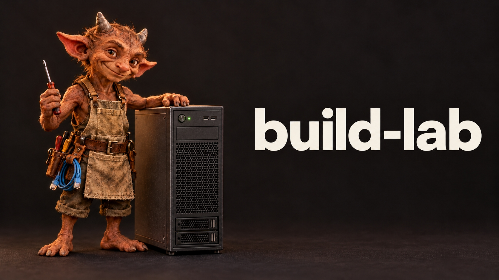
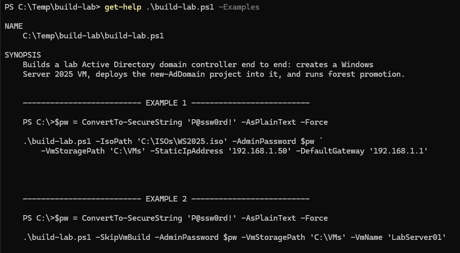
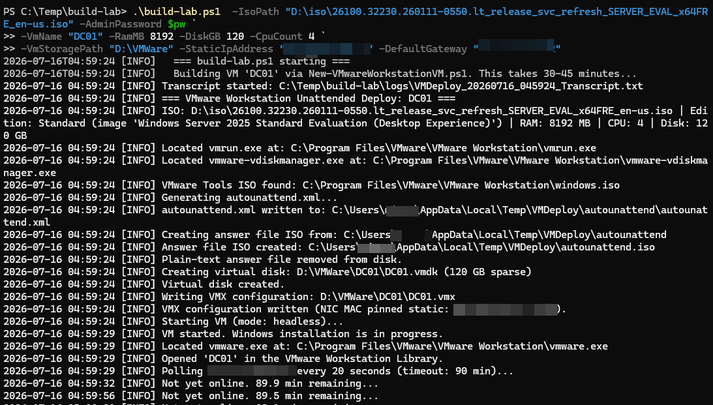
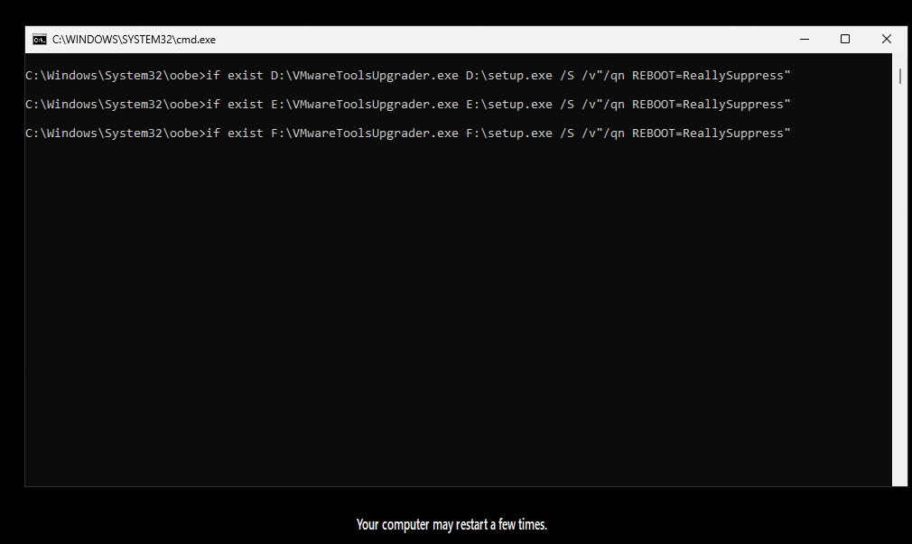
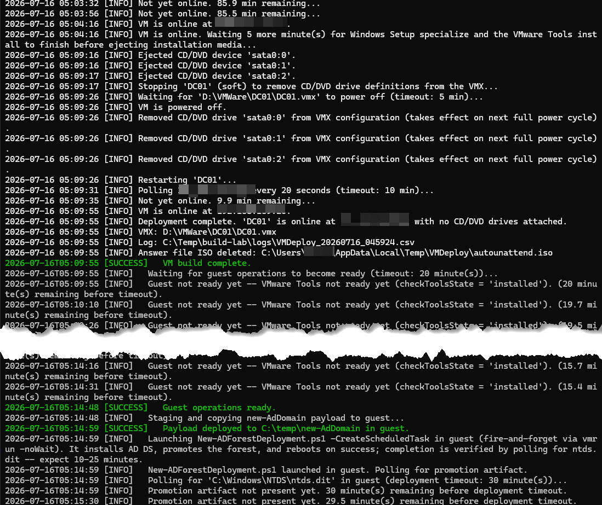
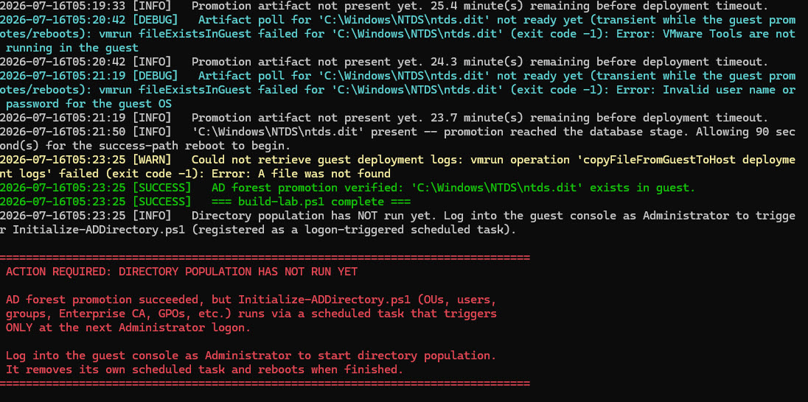
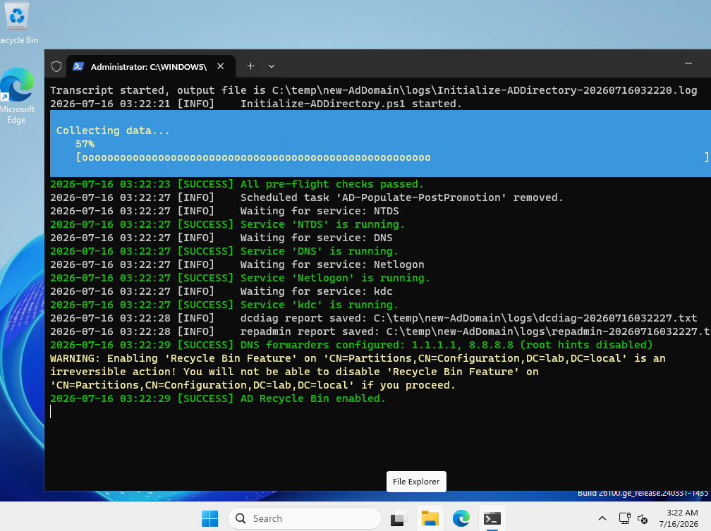



# build-lab

[](LICENSE)
[](https://learn.microsoft.com/powershell/)
[](https://www.microsoft.com/windows)
[](https://www.vmware.com/products/workstation-pro.html)

Stands up a lab Active Directory domain controller from an ISO in one command. It builds the Windows Server 2025 VM, promotes the forest, and fills it with a lived-in AD domain without you having to log in. Ask for member servers and it builds those too and joins them to the new domain, in the same run or later against the DC you already have.

I designed this because I like a fresh lab environment, but I do not like building a lab for the umpteenth time when the lab build may take more time than what I wanted to test.

## Why?

There are plenty of ways to deploy a Windows Server VM. There are plenty of scripts that promote an AD forest. There are even a few scripts that will give you that "lived in" feel.

What I could not find was one command that goes the whole way, ISO to a domain with objects in it, never opens a GUI, still leaves enough of a log trail to tell you why the script broke on the day it breaks, and requires exactly zero tooling outside of what Microsoft and VMware ship as part of the OS and hypervisor. So I wrote one.

## What It Does

`build-lab.ps1` is an orchestrator. It does not build a VM or promote a forest itself. It drives two sibling projects and stitches them together so one command takes you from an ISO to a promoted domain controller. Specifically:

1. Calls `New-VMwareWorkstationVM.ps1` to create and start a Windows Server 2025 VM with the CPU, RAM, disk, and static network settings you pass in.
2. Copies the `new-AdDomain` project into a staging folder on the host, drops in your [build profile](#build-profiles) if you gave one, and checks the staged copy before anything is built. Then it zips that same copy, pushes it into the guest at `C:\temp\new-AdDomain` over vmrun VIX guest operations, and verifies the payload landed.
3. Launches `New-ADForestDeployment.ps1` inside the guest to install AD DS and promote the forest.
4. Waits for the new directory to answer, starts `Initialize-ADDirectory.ps1` in the guest over vmrun, and waits for it to finish. That is the step that creates the OUs, users, groups, Enterprise CA and GPOs.
5. If you asked for member servers, builds them one at a time with the same VM builder (`SRVR-01`, `SRVR-02`, and so on) and joins each one to the new domain as a plain member.

```text
build-lab.ps1
      │
      ▼
New-VMwareWorkstationVM.ps1 ──► Windows Server 2025 VM
      │
      ▼
new-AdDomain payload ────────► C:\temp\new-AdDomain in the guest
      │
      ▼
New-ADForestDeployment.ps1 ──► forest promoted, verified by ntds.dit, a reboot, and the DC role
      │
      ▼
Initialize-ADDirectory.ps1 ──► a domain with things in it, started by build-lab over vmrun
      │
      ├──► optional: SRVR-01..NN built and joined to the domain
```

Here is the part that trips people up, so read it before you run anything.

Successful AD promotion immediately reboots Windows, which tears down the vmrun guest-operations channel mid-call. A blocking call hung on that reboot and never came back, so the guest script is launched fire-and-forget. That means there is no exit code to read at all, not even an untrustworthy one. So build-lab checks what it can see from the outside, in order. `C:\Windows\NTDS\ntds.dit` has to appear. Then the DC has to reboot, which build-lab detects with a registry key it plants just before the launch. Only a restart can remove it. Then the rebooted guest has to report itself as a domain controller in the domain you configured. Miss any of those and the run fails. The guest's own deployment logs are pulled back either way, so you can read why.

Directory population used to need you to log in once. It doesn't anymore. Creating OUs, users, groups, the Enterprise CA, and GPOs is `Initialize-ADDirectory.ps1`'s job, and build-lab now starts it the same way it starts the deployment, fire-and-forget over vmrun, with nothing stored in the guest. No password, no startup task. The script writes a small marker file when it starts and again when it ends, and build-lab polls that file until it says the population for this run succeeded or failed. Then it pulls the logs and the results back, and only after a success does it build any member servers. If you'd rather log in and watch it happen, `-DeferPopulation` gives you the old logon-triggered task and the red banner that goes with it.

## Features

- One command takes you from an ISO to a promoted domain controller. No GUI, no answer-file editing, no clicking Next.
- Build profiles. `-ProfilePath` builds a different forest from a small `.psd1` file, and neither repository gets edited.
- Promotion is confirmed by evidence from the guest, not by trusting a process that reboots out from under you. `ntds.dit` has to be on disk, the DC has to reboot, and it has to come back as a domain controller in the right domain.
- Member servers on request. `-MemberServerCount` builds and joins them after the DC is verified, and `-AddMemberServers` adds more to a DC you already have without touching the DC.
- `-MoveMemberServers` files those members into `OU=Servers` once directory population has created it.
- Every static address is pinged before a VM gets it, so you do not end up with two machines fighting over one IP.
- Directory population runs unattended after promotion, and a population that fails ends the run before any member server is built. `-DeferPopulation` keeps the old start at your first logon.
- The orchestrator's logs, the VM builder's, and the guest's own all land in one folder.
- Key events go to the Windows Application event log, if you want a SIEM to see this.
- `-SkipVmBuild` re-runs just the guest phases against a VM you already built and have not promoted yet.

## What's Changed Since 1.0

1.0 built one domain controller. The current version still does that, the same way, and adds member servers, build profiles, an override file for your standing settings, and a fair amount of hardening that came out of reviews and live runs.

**Upgrading?** From 2.2 on, every setting you might change lives in an override file that upgrades leave alone, and a small script moves the edits you already made into it. [UPGRADE.md](UPGRADE.md) has the steps from 2.2, 2.1, 2.0 and 1.0.

### What's New in 2.3

**What you must do.**

- **Upgrade all three projects together.** build-lab 2.3 goes with new-AdDomain 2.2 and New-VMwareWorkstationVM 1.2. An older new-AdDomain stops every run before a VM exists, and the message says what it lacks. An older VM builder gets a WARN.
- **Register the event source once per host.** build-lab no longer registers it for you. From an elevated PowerShell prompt in the build-lab folder, run the line below once on each host where you want build-lab's events. Until you do, a run writes no events and logs one WARN saying so.

  ```powershell
  .\Register-EventLogSource.ps1 -SourceName 'build-lab'
  ```

- **Update anything that filters on build-lab's event IDs.** Alerts, SIEM queries and scheduled tasks keyed on the old IDs stop matching. The new IDs follow a fixed map:

  | Old ID | New ID | Meaning |
  |---|---|---|
  | 1000 | 1000 | Run started |
  | 1001 | 1001 | Run finished. 2.2 wrote it on every exit, 2.3 only when the run completed |
  | none | 1002 | Run stopped before it finished (Error) |
  | 1100, 1200, 1300, 1400, 1500, 1600, 1700 | 3000 | A step that worked. The message names the step |
  | none | 3000 | Directory population launched, and directory population finished |
  | 1650 | 9000 | A member server failed |
  | 9999 | 9000 | The run failed |

**Breaking and behavior changes.**

- **Directory population runs on its own.** A full build and `-SkipVmBuild` wait for the new directory to answer, start `Initialize-ADDirectory.ps1` in the guest over vmrun, and wait for it to finish. You no longer log into the DC to start it. The run takes longer because of it, since it now ends after population instead of at the red banner. `-DeferPopulation` keeps the old behavior.
- **Member servers are built after population.** They used to be built while population waited for your logon. They still land in `CN=Computers`, so `-MoveMemberServers` is still its own run.
- **A failed population fails the run.** A population that fails in the guest, never starts, or doesn't finish within `-PopulationTimeoutMinutes` (240 by default) stops the run before any member server is built, with exit code 1.
- **No more automatic event source, and no fallback.** 2.2 registered the `build-lab` source when it ran elevated, and wrote under the built-in `Application` source when it couldn't. 2.3 never registers a source and never borrows another one.
- **A second guest folder in `logs`.** A build that runs population retrieves a second `guest-<timestamp>\` folder, with population's logs, its completion marker and its result files.
- **Some log texts changed.** Event 1300's message names `-CreateScheduledTask` only when it was passed. The "Directory population has NOT run yet" line and the red banner's population part appear only with `-DeferPopulation`. The `-MoveMemberServers` stop for a missing `OU=Servers` now describes both ways population runs.
- **Some stop texts changed too.** The stop for an older sibling says what the older release lacks. The member cap stop and the add run's DC mismatch stop name build-lab's override file as a place the count, the mask or the gateway can come from. The vmrun errors from the add and move runs' read of the DC say `query machine identity` where they said `query DC identity`.
- **new-AdDomain's build profile texts changed.** build-lab checks your profile the way the guest will, so its log and its stops carry these too. The WARN for an empty reserved key (`BuildName`, `CertificateAuthority`, `Machines` or `Trusts`), the stop for one with a value, and the end of the "did you mean" hint for an older key name are reworded. new-AdDomain's [What's New in 2.2](https://github.com/0x44616e69656c/new-AdDomain/blob/main/README.md#whats-new-in-22) quotes the new lines.
- **An override `MemberServerCount` is set aside in move and `-SkipVmBuild` runs.** Those runs build no members, so instead of stopping on the value (see Bugs fixed) they leave it unused and log one INFO line saying so. When the value isn't a whole number from 0 to 99, or is above the `MaxMemberServerCount` cap, that line is a WARN.
- **The guest-ready wait can end sooner.** It now tries the guest while VMware Tools still reports `installed`, so a guest that already answers is picked up then, not when the state finally reads `running`. Anything that times a build may see that wait end at a different point.
- **A network check before anything is built.** On `nat`, `hostonly` and a custom VMnet, a full build and `-AddMemberServers` now look at your host's own adapters first. The run stops when the network's host adapter is on another subnet, when your host's route to the DC leaves by some other adapter, or when no host adapter is on the DC's subnet at all. Each of those used to cost you the VM builder's whole timeout and a failed run anyway, because build-lab confirms every VM with a ping from your host. Murkier cases, such as a second adapter on the same subnet, are a WARN and the build goes on. If your host won't let build-lab read its adapters or its route, that's a WARN too, never a stop. `bridged` isn't checked.
- **A mask you didn't set follows the host adapter.** When neither `-SubnetMask` nor the override file gives one, the VMs take the prefix of the network's host adapter. On NAT that's the /24 it always was, so nothing changes there. A mask you did give is kept, with a WARN when it disagrees with the adapter.
- **`-AddMemberServers` follows the DC's network.** It reads the network from the DC's VMX file and builds the members there. If the run asked for a different one, you get a WARN naming both, because members on another network could never reach the DC to join it.
- **New log lines.** Every run logs a `Network:` line naming the network and where it came from, and full builds and add runs log `Network check:` lines.
- **Two more files in `logs`.** Every run writes a build manifest, `build-lab-manifest_<timestamp>.csv`, beside its log, and full builds and add runs keep `iso-sha256-cache.csv` there as well. Anything that expects a fixed set of files in `logs` will see them. The first build against an ISO hashes it, which took 12 to 21 seconds for an 8 GB ISO on a fast NVMe disk and will take longer on a spinning one. Later builds take the hash from the cache.
- **Hidden files the guest uses stop the run.** The payload zip can't carry hidden files or folders. So a run now stops before any VM is built when new-AdDomain holds a hidden `.ps1`, `.psd1`, `.csv` or `.json`, or one inside a hidden folder, or when the build profile you pass is hidden, and the message names each. Clear the attribute with `attrib -h` and run again. Anything else hidden, such as `desktop.ini`, gets one WARN naming it and is left out, as it always was.
- **Staging gives up on a stuck file.** Copying new-AdDomain into the run's staging folder now tries a file it can't copy twice, five seconds apart, and stops after 10 minutes in all. It used to wait with no limit.
- **A gateway from New-VMwareWorkstationVM's override file is checked.** Without `-DefaultGateway` the VMs still get that file's `DefaultGateway`, as before. build-lab now logs it with a WARN, and stops before anything is built when the VMs couldn't use it, such as a gateway outside the DC's subnet.
- **`Build manifest:` lines in the log.** Every run logs at least one, naming the file it wrote. A copy of a project without `.git`, such as a release download, adds one line saying no commit is recorded for it. A WARN that starts `Build manifest:` means part of the record couldn't be read, and the build carried on regardless.

**New.**

- **A build manifest.** One CSV per run that says what was built, from what, and how the run ended, without anyone reading the log. It records each project's version and git commit, the ISOs' SHA-256, the build profile, the domain, network and population values with their sources, and each VM's role, address and OS build. See [The build manifest](#the-build-manifest).
- **Custom VMnets.** `-NetworkType` now takes `VMnet0` to `VMnet99` as well as `nat`, `bridged` and `hostonly`, so two labs can build side by side on separate host-only networks. A build profile can pick the network with its own `NetworkType` key, and the override file can too. The VMnet has to exist already, and it needs New-VMwareWorkstationVM 1.2. See [Two labs on separate networks](#two-labs-on-separate-networks).
- **`-DeferPopulation` and `-PopulationTimeoutMinutes`.** Both can also be set in the override file. See [Parameters](#parameters).
- **A `Population settings:` line in every run's log.** It names the `Population`, `DomainAdminCount` and `PopulationSeed` the guest will use, and whether each came from the build profile, new-AdDomain's override file or the defaults.
- **A support check before anything is built.** A full build or `-SkipVmBuild` stops before any VM when the staged new-AdDomain can't report its population back to build-lab, and says to update it or pass `-DeferPopulation`.
- **An example override file.** `examples\overrides.psd1` lists every setting, commented out at its shipped value. [Overrides](#overrides) has a command that copies it into place without touching a file you already have.
- **`Register-EventLogSource.ps1`** ships beside `build-lab.ps1`, for the one-time step above.
- **License and source in every script's help.** Each script's help names its license, `SPDX-License-Identifier: MIT`, and links to this repository, so `Get-Help .\build-lab.ps1 -Online` opens it. The files in `include\` and `Register-EventLogSource.ps1` are shared with the other lab projects, so they link to my GitHub profile instead.

**Bugs fixed.**

- The guest-ready wait could run out its time on a working guest. VMware Tools can go on reporting `installed` for a while after the guest's last restart, and build-lab only tried the guest once the state read `running`. Since 1.0.
- A `MemberServerCount` in the override file stopped every `-MoveMemberServers` and `-SkipVmBuild` run, with a message about a `-MemberServerCount` you never passed. Since 2.2.
- `-SkipVmBuild` stopped when the VM builder wasn't there, though it never runs the builder. From 2.2 it also checked the builder's version, and stopped on a builder older than 1.1 that had an override file. Since 1.0.
- The member cap stop told you to lower `-MemberServerCount` when the count came from `MemberServerCount` in the override file, and the add run's DC mismatch stop never mentioned that file as a source of the mask or the gateway. Since 2.2.
- A `-SubnetMask` of `0.0.0.0` stopped `-MoveMemberServers`, which never uses the mask. Since 2.0.
- When vmrun reported that the forest deployment's launch had failed, build-lab still wrote the Information event saying it was launched, event 1300 then and 3000 now. The run went on to the promotion check either way, which still names the launch error. Since 2.0.
- When the file `-ProfilePath` named went missing or was held open between build-lab's check of it and the copy, the run went on without it, with new-AdDomain's own build profile or none, while the log named the file you asked for. Since 2.1.
- A hidden file the guest uses, such as a hidden `overrides\overrides.psd1`, or any file in a hidden folder, was left out of the payload the guest gets without a word, though from 2.1 the host had already checked it. Since 1.0.
- Two runs sharing a `logs` folder copied the guest's logs through the same `adDeploymentLogs.zip`, so one run could unpack the other's logs, or lose its own when the other deleted the file first. Since 1.0.
- Staging new-AdDomain had no retry or time limit, so one locked or unreachable file could stall the run for as long as robocopy's defaults allow, a million retries 30 seconds apart. Since 1.0.
- Without `-DefaultGateway`, a `DefaultGateway` in New-VMwareWorkstationVM's override file still reached every VM, unchecked, while an add run's log said the members got no gateway. Since 2.2.
- `Export-OverrideFile.ps1` wrote the comment above a migrated setting with the line number of the parameter's first attribute, not the line that holds its value. Since 2.2.

### New in 2.2

- **An override file.** `overrides\overrides.psd1` in the project folder holds the settings you keep from run to run, such as `-RamMB`, `-NetworkType` or the member server cap, so you stop retyping them and stop editing the script. Git ignores the folder, so `git pull` never touches it. A value on the command line still wins. Every key, its default and what it accepts is in [OVERRIDE.md](OVERRIDE.md). The two sibling projects have override files of their own, and build-lab hands new-AdDomain's to the guest with the rest of the payload.
- **A migration script.** `Export-OverrideFile.ps1` reads an older copy of build-lab without running it, and writes the defaults you edited into the new override file. new-AdDomain and New-VMwareWorkstationVM each ship their own.
- **Member work against an older DC needs no profile.** When nothing names a domain (no profile, no override file and no edit to `global-config.ps1`), `-AddMemberServers` and `-MoveMemberServers` read the DC's own domain from the DC and use it, with a WARN. A domain you did name still has to match the DC.
- **The siblings' versions are checked.** build-lab 2.2 goes with new-AdDomain 2.1 and New-VMwareWorkstationVM 1.1, and reads the version line of their scripts before it builds anything. An older new-AdDomain stops the run, with the version found and the version needed. An older VM builder is a WARN, unless it has an override file it would ignore. An older `global-config.ps1` copied over the new one stops the run too, and the message says that is what happened.
- **A changed default is named.** When a shipped default changes from one release to the next, and your run didn't set that setting itself, the log gets one INFO line naming the old and new value and the override key that keeps the old one. 2.2 changes none of build-lab's defaults, so you won't see one from build-lab this time.
- **More of the guest's checks happen on the host first.** The staged copy of new-AdDomain is read with its override file in place, so a bad value there stops the run before a VM exists. A replacement `serviceaccounts.csv` gets the same placeholder check as the shipped one. An SPN that names a host in another domain gets the guest's WARN on the host as well, in a run that deploys the DC. A count minimum set above its maximum, both in new-AdDomain's override file, stops the run.

### New in 2.1

#### Breaking for 2.0 users

Updating from 2.0 changes three things you may rely on. The first two stop the run before anything is built or changed, and the message tells you what to do. The third stops nothing, which is exactly why it is on this list.

1. **Update new-AdDomain at the same time.** build-lab 2.1 refuses new-AdDomain 1.0. Put new-AdDomain 2.0 next to it, or point `-AdDomainSourcePath` at a 2.0 copy.
2. **A DC built by 2.0 needs a profile for member work.** That DC is in `lab.local`, so `-AddMemberServers` and `-MoveMemberServers` against it stop at the DC check. Pass the `lab.local` profile from [A DC built before lab.test](#a-dc-built-before-labtest).
3. **The same full-build command now builds `lab.test`.** A command line that gave you `lab.local` under 2.0 gives you `lab.test` under 2.1, with no warning. Pass that same profile to a full build if you want `lab.local` back, and expect a WARN reminding you that `.local` is reserved for multicast DNS.

#### Everything else in 2.1

- **Build profiles.** `-ProfilePath` takes a `.psd1` file that names the domain, the NetBIOS name, the site and a few other settings, and builds that forest instead of the default. See [Build Profiles](#build-profiles).
- **A WARN when a file you did not name picks the forest.** A `build-profile.psd1` left sitting in the `new-AdDomain` folder still gets used, and the log names it with its SHA-256.
- **The staged copy is checked before anything is built.** A bad profile, a bad `global-config.ps1` value, or a misspelled SPN placeholder in `serviceaccounts.csv` stops the run before a VM exists. The guest then runs exactly the files that were checked.
- **An early address check.** An explicit `PrimarySubnet` that does not contain the DC's address gets a WARN before the build starts, instead of a surprise after it.
- **It needs new-AdDomain 2.0.** build-lab 2.1 checks the staged copy with new-AdDomain's own `include\BuildProfile.ps1`, which first ships in new-AdDomain 2.0. Point it at a 1.0 copy and it stops before anything is built, with a message that says so. new-AdDomain 2.0 is also where most of the changes inside the guest come from. The DC lands in its own renamed site with its own subnet, `Win2025` functional levels work, the service account SPNs follow the domain, and the test results file grows from nine rows to fifteen. See [what changed in new-AdDomain](https://github.com/0x44616e69656c/new-AdDomain#whats-changed-since-10).
- **The default domain is now `lab.test`.** That change lives in `new-AdDomain`. A DC built earlier is in `lab.local`, so `-AddMemberServers` and `-MoveMemberServers` against it need a profile. See [A DC built before lab.test](#a-dc-built-before-labtest).

### New in 2.0

- **Member servers.** `-MemberServerCount` builds `SRVR-NN` member servers after the DC's promotion is verified and joins them to the domain. They have their own size parameters. See [Member Servers](#member-servers).
- **`-AddMemberServers`.** Adds member servers to an existing DC. The DC is checked, never changed.
- **`-MoveMemberServers`.** Moves the members from `CN=Computers` to `OU=Servers` after directory population has run.
- **A ping before every static address.** The DC's address and every member address are pinged before use and refused if anything answers.
- **The version is in the log.** The first log line names the script version (`=== build-lab.ps1 <version> starting ===`), so a log always says what produced it.

### Changed behavior (read this if you used 1.0)

- **An unverified promotion now fails the run.** 1.0 polled for `ntds.dit`, waited a fixed grace period, and reported success. Now the DC also has to reboot and come back as a domain controller in the expected domain, or the run exits with code 1 and says which check failed.
- **Addresses are checked up front.** On `-NetworkType nat`, a `-StaticIpAddress` outside `net.3` to `net.127` is refused before anything is built. So are the network or broadcast address of the subnet, a gateway outside the DC's subnet or equal to the DC's address, and a `0.0.0.0` subnet mask.
- **`-SkipVmBuild` refuses a promoted DC.** On a working DC it could only delete the deployment logs and then fail, so it now stops before changing anything. It also cannot be combined with member servers. That is what `-AddMemberServers` is for.
- **Windows PowerShell 5.1 (Desktop) is enforced** with `#Requires`. 1.0 targeted 5.1 without enforcing it.
- **More passwords are refused before the build.** An empty password, and one that contains whitespace and ends in a backslash, join the double quote on the reject list. All three break vmrun's command-line quoting or Windows setup.

### Under the hood

- Every vmrun call has a host-side time limit, and a call that overruns is killed. One stuck call can no longer hold the run open forever.
- vmrun output is read as UTF-8 whatever your console's code page is, so non-ASCII text in vmrun's messages is not mangled.
- Commands run in the guest report back through a small result file, so a failure comes back with the guest's own error text.
- Each run has its own staging folder (`%TEMP%\BuildLab-<timestamp>-<PID>`), and each VM build gets its own answer-file folder inside it. Two runs on the same host no longer share, or delete, each other's answer-file ISO.
- The log bundle build-lab copies out of the guest (`C:\temp\adDeploymentLogs.zip`) is deleted from the guest once it is on the host.
- New event IDs for the member server steps. See [Logs](#logs).

## Screenshots

**1. The built-in help.** `Get-Help .\build-lab.ps1 -Examples` gives you the synopsis and the invocation patterns without opening the script. This screenshot is from 1.0. The help now carries seven examples, including the member server modes, a build profile and two labs on separate networks.



**2. Kicking off a full build.** The command line and the first minute of output. The ISO edition is identified, `autounattend.xml` is generated, the virtual disk and VMX are written, and the VM starts headless.



**3. The guest, mid-install.** Unattended Windows Setup running in the VM with the VMware Tools installer firing from the OOBE pass. Nothing to do here but wait.



**4. The VM build finishes and hands off.** Installation media is ejected, the CD/DVD drives are stripped out of the VMX, and the VM restarts. Then guest operations come up, the `new-AdDomain` payload lands in `C:\temp\new-AdDomain`, promotion launches fire-and-forget, and the poll for `ntds.dit` begins.



**5. The banner you must not ignore.** This one and the next are from before 2.3, when every build ended here. From 2.3 you only see the banner with `-DeferPopulation`. `ntds.dit` appears, promotion is verified, and the red banner tells you directory population still needs a manual logon. Those `[DEBUG]` polling lines above it look alarming. They are not. "VMware Tools are not running" and "Invalid user name or password" are what a guest mid-reboot looks like from the outside, and the poll is built to shrug them off and keep going. The `[WARN]` about guest log retrieval is the same story, and the run still reports success.



**6. Directory population, once you log on.** This is the manual step the banner was shouting about. `Initialize-ADDirectory.ps1` fires from its scheduled task, removes that task, verifies the services, saves dcdiag and repadmin reports, sets DNS forwarders, and turns on the AD Recycle Bin.



## Requirements

- **VMware Workstation 17 or newer.** The script finds `vmrun.exe` under the standard Program Files install paths, both `Program Files` and `Program Files (x86)`.
- **Windows PowerShell 5.1.** This targets 5.1, where `Write-EventLog` is the correct API, and refuses to start anywhere else. See [Known Limitations](#known-limitations) if you are thinking about a PowerShell 7 port.
- **Local Administrator on the host, once,** to register the `build-lab` event log source with `Register-EventLogSource.ps1` (see [What's New in 2.3](#whats-new-in-23)). build-lab itself runs unelevated. It checks for the source at the start of each run, and when the source isn't there it writes no events and logs one WARN. The guest operations authenticate against the guest, not the host.
- **A Windows Server 2025 ISO.** The DC and every member server are built from it.
- **The two sibling projects.** `New-VMwareWorkstationVM` and `new-AdDomain` are expected to sit next to this project on disk (`..\New-VMwareWorkstationVM` and `..\new-AdDomain`). If you keep them somewhere else, point at them with `-VmBuilderScriptPath` and `-AdDomainSourcePath`. The domain name comes from new-AdDomain's override file or `include\global-config.ps1`, or from the [build profile](#build-profiles) when you use one.
- **new-AdDomain 2.2 and New-VMwareWorkstationVM 1.2.** Those are the releases that go with build-lab 2.3. new-AdDomain 2.2 is the first that build-lab can start population in and hear back from. build-lab reads each one's version before it builds anything. An older new-AdDomain stops the run, with a message naming the version it found, the one it needs, and what the older release lacks. An older VM builder gets a WARN. Custom VMnets need New-VMwareWorkstationVM 1.2 as well. An older builder can't take them, and build-lab stops before building anything when you ask for one.

```text
Sibling Projects/
├── build-lab/
├── New-VMwareWorkstationVM/
└── new-AdDomain/
```

### All the stuff you need to make this script work

- [VMware Workstation Pro (Free)](https://knowledge.broadcom.com/external/article/368667/download-and-license-vmware-desktop-hype.html)
- [Windows Server 2025 (Evaluation)](https://www.microsoft.com/en-us/evalcenter/evaluate-windows-server-2025)
- [New-VMwareWorkstationVM](https://github.com/0x44616e69656c/New-VMwareWorkstationVM)
- [New-AdDomain](https://github.com/0x44616e69656c/new-AdDomain)

## Tested On

- **Windows 11 host, VMware Workstation Pro 26H1.** Full build verified end to end, from the VM build through the payload copy to forest promotion. The script's floor is Workstation 17+, which is what the vmrun guest-operations calls need, but 26H1 is what the end-to-end runs have actually been against. You are updating your software, right?
- **Windows Server 2025 Standard Evaluation (Desktop Experience), `SERVER_EVAL_x64FRE` media.** Built at 8 GB RAM, 4 vCPU, and a 120 GB disk. Other editions and VL or retail media are unverified. The unattended install matches on exact edition name strings, and those differ between evaluation and VL media, so expect to adjust if you switch.
- **Member servers, same host and Workstation 26H1.** Verified end to end at the default sizes, a 4 GB / 2 vCPU DC with 2 GB / 1 vCPU members. That covered full builds with two members, including two labs building side by side on one host, a DC-only build followed by `-AddMemberServers`, number skipping and reuse, and the move to `OU=Servers`.
- **Build profiles, with new-AdDomain 2.0.** The 2.1 changes were run on live VMs in all four modes, `-SkipVmBuild` among them against a promoted DC, where stopping is its job. The builds ran with no profile, with a profile at the `WinThreshold` and `Win2025` levels, and with a profile left in the `new-AdDomain` folder that clashes with an existing site and subnet.

## Quick Start

Clone all three projects into the same folder. build-lab looks for the other two right beside it.

```powershell
git clone https://github.com/0x44616e69656c/build-lab.git
git clone https://github.com/0x44616e69656c/new-AdDomain.git
git clone https://github.com/0x44616e69656c/New-VMwareWorkstationVM.git
cd build-lab
```

Downloaded the zips instead? Windows blocks files downloaded from the internet by default, and a `RemoteSigned` execution policy won't run a blocked script. Look the files over, then unblock all three projects from the folder that holds them:

```powershell
Get-ChildItem -Recurse -File | Unblock-File
```

Then run it:

```powershell
$pw = ConvertTo-SecureString 'P@ssw0rd!' -AsPlainText -Force
.\build-lab.ps1 -IsoPath 'C:\ISOs\WS2025.iso' -AdminPassword $pw `
    -VmStoragePath 'C:\VMs' -StaticIpAddress '192.168.220.50' -DefaultGateway '192.168.220.2'
```

**Pick that IP carefully, because it is the one thing that will quietly ruin your afternoon.** `-NetworkType` defaults to `nat`, which puts the guest on VMnet8. Workstation always allocates a NAT network as a Class C and hands out fixed roles inside it:

| Address | Role |
|---|---|
| `net.1` | Host virtual network adapter. Reserved. |
| `net.2` | The NAT device. This is your gateway, and your DNS server. |
| `net.3` to `net.127` | Yours, for static IPs. |
| `net.128` to `net.254` | The virtual DHCP server's pool. Keep out. |

So `-StaticIpAddress` needs to be somewhere in `net.3` to `net.127`, and `-DefaultGateway` is always `net.2`. On NAT, build-lab refuses anything outside that range before it builds anything, and it pings the address first and refuses it if something already answers. It checks the subnet too, against your own host. VMnet8's host adapter has to hold the address, and your host's route to it has to leave by that adapter. Get either one wrong and the run stops before it builds anything, which beats the old behavior of sitting there politely polling an address that could never answer until the VM builder timed out.

The subnet is the part nobody can tell you. Workstation picks it when you install it and it differs from host to host, so `192.168.220.0/24` above is illustrative, not a default. Yours is in Edit > Virtual Network Editor > VMnet8.

The run in the screenshots above took about twenty-five minutes from start to red banner on a reasonably quick host. From 2.3 a default build doesn't stop at a banner. It carries on through directory population. On my test host a 2.3 build of a DC with the full population took 24 minutes, and the same build with one member server took 39. Each member server adds roughly another twelve to fifteen minutes. Budget an hour at least and go do something else. The default timeouts allow for considerably longer than that before anything gives up, which is fine for a build you are not watching. With `-DeferPopulation` the run still ends at the red banner, and you log into the guest console as Administrator to start directory population.

## Additional Examples

### A build with the knobs turned up

The Quick Start uses the fewest parameters that work. This shows a few more options. Many of these, like `-DeploymentTimeoutMinutes`, you will never need.

```powershell
$pw = ConvertTo-SecureString 'P@ssw0rd!' -AsPlainText -Force
.\build-lab.ps1 -IsoPath 'D:\ISOs\WS2025.iso' -AdminPassword $pw `
    -VmStoragePath 'D:\VMs' -VmName 'DC01' -ComputerName 'DC01' `
    -RamMB 8192 -CpuCount 4 -DiskGB 120 `
    -StaticIpAddress '192.168.220.50' -SubnetMask '255.255.255.0' `
    -DefaultGateway '192.168.220.2' -DnsServer '1.1.1.1' `
    -DeploymentTimeoutMinutes 45
```

Those are roughly the specs behind the screenshots above. 4 GB and 2 vCPU are the defaults and they do work, but AD DS is happier with more, and the build finishes sooner. `-DeploymentTimeoutMinutes 45` buys headroom on a slow host. Raising it costs nothing when the build succeeds, because the poll exits as soon as `ntds.dit` appears.

### A different forest from a build profile

```powershell
$pw = ConvertTo-SecureString 'P@ssw0rd!' -AsPlainText -Force
.\build-lab.ps1 -IsoPath 'C:\ISOs\WS2025.iso' -AdminPassword $pw `
    -VmStoragePath 'C:\VMs' -VmName 'CORPDC01' -ComputerName 'CORPDC01' `
    -StaticIpAddress '192.168.220.50' -DefaultGateway '192.168.220.2' `
    -ProfilePath 'C:\LabProfiles\corp.psd1'
```

Same build as the Quick Start, but the forest is whatever `corp.psd1` says. Keep your profiles outside both repositories, and each lab's forest settings live in one file you can hand to someone else. [Build Profiles](#build-profiles) has what goes in the file and which profile wins when there is more than one around.

### A DC with member servers

```powershell
$pw = ConvertTo-SecureString 'P@ssw0rd!' -AsPlainText -Force
.\build-lab.ps1 -IsoPath 'C:\ISOs\WS2025.iso' -AdminPassword $pw `
    -VmStoragePath 'C:\VMs' -VmName 'DC01' -ComputerName 'DC01' `
    -StaticIpAddress '192.168.220.50' -DefaultGateway '192.168.220.2' `
    -MemberServerCount 2
```

The DC is built and verified first, exactly as above, and directory population runs to the end. Then `SRVR-01` at `.60` and `SRVR-02` at `.61` are built, pointed at the DC for DNS, and joined to the domain. The members are not built at all unless the promotion is verified and population finishes. With `-DeferPopulation` they're built straight after the promotion.

### Adding member servers to a DC you already have

```powershell
$pw = ConvertTo-SecureString 'P@ssw0rd!' -AsPlainText -Force
.\build-lab.ps1 -AddMemberServers -AdminPassword $pw -VmStoragePath 'C:\VMs' -VmName 'DC01' `
    -IsoPath 'C:\ISOs\WS2025.iso' -StaticIpAddress '192.168.220.50' -DefaultGateway '192.168.220.2' `
    -MemberServerCount 1
```

`-VmStoragePath` and `-VmName` find the existing DC. `-StaticIpAddress` is the DC's own address, because the members are numbered from it and use it for DNS. Before anything is built, build-lab checks that the VM really is that DC. It looks for `ntds.dit`, the domain from `global-config.ps1` (or the build profile, if the DC was built with one, so pass it again with `-ProfilePath`), the address and prefix length you passed, and the gateway if you passed one. Leave `-DefaultGateway` off and the DC's gateway goes unchecked. The new members then get none, unless New-VMwareWorkstationVM's override file sets `DefaultGateway`. They get that one, and the log says so with a WARN. The DC itself is never changed. No payload copy, no redeployment.

Numbering picks up where the lab left off. Names already used by a VM folder, by the DC, or by a computer object in AD are skipped, so this example gets `SRVR-03` in a lab that already has two members.

### Moving member servers into OU=Servers

```powershell
$pw = ConvertTo-SecureString 'P@ssw0rd!' -AsPlainText -Force
.\build-lab.ps1 -MoveMemberServers -AdminPassword $pw -VmStoragePath 'C:\VMs' -VmName 'DC01'
```

Run this once directory population has finished, because `OU=Servers` does not exist until then. After a default full build that is straight away. After a build with `-DeferPopulation` it means logging into the DC and letting population finish first. It builds nothing. See [Member Servers](#member-servers).

### Re-running against a VM you already built

```powershell
$pw = ConvertTo-SecureString 'P@ssw0rd!' -AsPlainText -Force
.\build-lab.ps1 -SkipVmBuild -AdminPassword $pw -VmStoragePath 'C:\VMs' -VmName 'LabServer01'
```

`-SkipVmBuild` reuses the existing VMX at `<VmStoragePath>\<VmName>\<VmName>.vmx` and jumps straight to copying the payload, promoting, and running directory population, unless you pass `-DeferPopulation`. Good for iterating on the domain build without paying the VM-build tax every time. Pass the same `-VmStoragePath` and `-VmName` you built the VM with. Note it re-runs the whole guest phase every time. It does not pick up a failed build where it left off.

It only works on a VM that has not been promoted. If `ntds.dit` is already there, it stops before touching anything. Re-running the deployment on a working DC would delete its logs and then fail anyway, because AD DS is already installed. To retry a deployment, revert the VM to a snapshot from before it was promoted. To add members to a DC, use `-AddMemberServers`, not this.

Two more things to know before you reach for it. `-SkipVmBuild` and `-StaticIpAddress` are in different parameter sets, so you cannot pass an address here even if you want to, and the guest script gets called without the network arguments. On a VM that already has its static IP from the original build, that is fine. It only matters if the guest fell back to DHCP and you were counting on this run to repair it, which it will not.

The other one is destructive. Copying the payload deletes `C:\temp\new-AdDomain` first, and the guest's own deployment logs live inside that folder. Re-running with `-SkipVmBuild` throws them away before it starts. Pull anything you still want out of the guest first.

You could also log into the guest and run `New-ADForestDeployment.ps1` with its own parameters. Options. We have options.

## Member Servers

Member servers are Windows Server 2025 VMs built with the same VM builder as the DC, joined to the domain, and left as plain members.

- **When they are built.** In a full build, only after the DC's promotion is verified and directory population has finished, or straight after promotion with `-DeferPopulation`. With `-AddMemberServers`, after the existing DC has passed its checks. Always one at a time.
- **Names.** `SRVR-NN`, with the VM name and the computer name the same. Each run takes the lowest free numbers, gaps first. A number counts as taken if its folder exists under `-VmStoragePath`, if it matches the DC's `-VmName` or `-ComputerName`, or (with `-AddMemberServers`) if AD already has a computer object with that name. Delete both the VM folder and the AD object and the number becomes free again.
- **Addresses.** Each member's address follows its number, at DC address + 10 + (number - 1). With the DC at `.50`, `SRVR-01` is `.60` and `SRVR-05` is `.64`, whichever run builds it. Every address is checked and pinged before anything is built, and pinged again just before that member's build. On NAT the whole range has to stay at or below `net.127`, so a DC near the top of the static range leaves no room for members.
- **Network.** DNS is the DC's address. Members get the run's network, mask and `-DefaultGateway`. Without `-DefaultGateway` they get the one in New-VMwareWorkstationVM's override file if it sets one, which build-lab checks against the DC's subnet and logs with a WARN, and otherwise none. With `-AddMemberServers` the network is the one in the DC's VMX file, because members anywhere else couldn't reach the DC. If you asked for a different one, the log says so with a WARN.
- **Size.** `-MemberRamMB` (2048), `-MemberCpuCount` (1) and `-MemberDiskGB` (60).
- **The join.** `Add-Computer` runs in the guest as the domain's built-in Administrator, which has the same password as `-AdminPassword`. The reboot that completes the join is launched separately, and build-lab waits until the guest has actually rebooted and reports membership of the domain. `-DomainJoinTimeoutMinutes` (20) bounds that wait.
- **When one fails.** It is logged and the rest carry on. A summary at the end lists every member, and the run exits with code 1 if any failed. The DC is not affected.
- **Where they land.** In the domain's default `CN=Computers` container. A join always lands there, even after directory population has created `OU=Servers`, so the move is a separate later step. Run `-MoveMemberServers` once population has finished. It moves only objects named exactly `SRVR-NN`, refuses to move anything if more match than the cap, re-checks afterwards that none were left behind, and is safe to run again.
- **How many.** A cap per run, the `MaxMemberServerCount` setting in the [override file](OVERRIDE.md). It is a setting and not a parameter because a scope limit is something you should only change on purpose.

## Build Profiles

A build profile is a small `.psd1` file that says which forest to build. Pass it with `-ProfilePath` and build-lab copies it into its staged copy of `new-AdDomain` as `include\build-profile.psd1`, which is where the guest scripts look for it. Neither repository gets touched, so you can keep a folder of profiles and build whichever lab you need today.

```powershell
@{
    DomainName      = 'corp.example.test'
    NetBIOSName     = 'CORP'
    PrimarySiteName = 'Corp-HQ'
    PrimarySubnet   = 'Auto'
}
```

A key you leave out keeps the value from new-AdDomain's override file, or its shipped value. The full list of keys, what each one accepts, and what happens to an empty or clashing value belong to `new-AdDomain`, so its [OVERRIDE.md](https://github.com/0x44616e69656c/new-AdDomain/blob/main/OVERRIDE.md#build-profile) is the place to look.

One key is build-lab's own. A profile's `NetworkType` picks the network the VMs join, such as `NetworkType = 'VMnet2'`. It wins over build-lab's override file, and `-NetworkType` on the command line wins over it, with a WARN when the two differ. The guest scripts check it and otherwise ignore it.

Before anything is built, build-lab reads the staged copy the same way the guest will. A typo, or a key it does not know, stops the run right there with the problem named, and the log points at your file rather than at the temp copy. The guest later runs exactly the files that were checked.

### Which profile a run uses

| `-ProfilePath` | `new-AdDomain\include\build-profile.psd1` exists | The run uses | The log says |
|---|---|---|---|
| Not given | No | No profile | INFO `No build profile` |
| Not given | Yes | That source profile | WARN naming its path and SHA-256 |
| Given | No | `-ProfilePath` | INFO with its path and SHA-256 |
| Given | Yes | `-ProfilePath` | WARN that the source profile was replaced, then the INFO |

The second row is the one to watch. A file you never named on the command line decides which forest gets built, and that deserves a WARN. It still builds. If you meant it, pass the same file with `-ProfilePath` and the warning goes away. The SHA-256 in the log is the hash of the copy the guest gets, so you can check it against the file you thought you were using.

### Members and moves need the same profile

`-AddMemberServers` and `-MoveMemberServers` pick the profile by the same rule, so pass the one the DC was built with. They compare its domain with the DC's real one and refuse a mismatch. A wrong profile stops the run instead of building members for the wrong domain.

### A DC built before lab.test

The default domain is now `lab.test`. A DC built with an older `new-AdDomain` is in `lab.local`. When nothing names a domain, the add and move runs read the DC's own domain and use it, with a WARN. A full build still gives `lab.test`. To keep building `lab.local`, set `DomainName` and `NetBIOSName` in new-AdDomain's override file, or save these two lines as a profile and pass it with `-ProfilePath`. Once a domain is named, the add and move runs check the DC against it again.

```powershell
@{ DomainName = 'lab.local'; NetBIOSName = 'LAB' }
```

### The early address check

In a full build with an explicit `PrimarySubnet` (anything other than `Auto`), build-lab checks that the DC's `-StaticIpAddress` sits inside it before building anything. A miss is a WARN and the build carries on. The guest then uses the DC's own subnet instead, and its "Requested subnet" test row fails, so the miss shows up in the test results as well as the log. That is the usual sign of a profile copied from another lab. The other three modes skip the check. `-SkipVmBuild` has no address to check, and the add and move modes never run directory population.

## Two labs on separate networks

NAT is fine for one lab, and two labs can even share it, but then they can see each other. If you want two forests that can't, give each one its own VMnet. They can even have the same name.

build-lab picks a network. It never makes one, and it never touches your host's networking. So the setup is yours, in Workstation's Virtual Network Editor.

1. Add a VMnet for each lab, VMnet2 and VMnet3 say. Make each one host-only.
2. Give each its own subnet. Two VMnets on the same subnet leave your host routing that subnet one way only, and the other lab's run stops on the network check.
3. Keep a host virtual adapter connected to each one. build-lab confirms every VM with a ping from your host, and without that adapter your host can't reach the VMnet at all.

Then run each build with its own `-NetworkType`, its own `-VmStoragePath` so the `SRVR-NN` member names don't collide, and no `-DefaultGateway`, because there's nothing to route to.

```powershell
$pw = Read-Host -Prompt 'Guest Administrator password' -AsSecureString
.\build-lab.ps1 -IsoPath 'C:\ISOs\WS2025.iso' -AdminPassword $pw -VmStoragePath 'C:\VMs\LabA' -NetworkType 'VMnet2' -StaticIpAddress '10.20.0.50'
```

And the same in a second window with `-VmStoragePath 'C:\VMs\LabB' -NetworkType 'VMnet3' -StaticIpAddress '10.30.0.50'`. A build profile can carry the network instead, with `NetworkType = 'VMnet2'`. The override file can set `NetworkType` too, but it applies to every build, so it suits a lab you always keep on one VMnet rather than two at once.

Before it builds anything, build-lab finds the VMnet's host adapter by the name Workstation gives it, `VMware Network Adapter VMnet2`, checks that the DC's address is in that adapter's subnet, and checks that your host's route to that address leaves through it. When you don't give a mask, the VMs take the adapter's prefix, so a /16 VMnet just works.

What the guests can't do on an isolated network matters more than what they can.

- **No internet, so no DNS forwarders and no time sync.** new-AdDomain's population sets DNS forwarders and points the DC at an internet time source. On an isolated VMnet neither one is reachable. Names outside the DC's own zones don't resolve, which is the point of isolation, and population logs a WARN when the time resync fails. Whether population can set forwarders that don't answer hasn't been tried on a live isolated build yet.
- **Windows Server evaluation media has a 10-day clock.** Microsoft's Evaluation Center page for Windows Server 2025 says evaluation versions "must be activated over the internet in the first 10 days to avoid automatic shutdown", and the 2019 and 2022 pages say the same. An isolated lab on evaluation media is a short-lived lab unless you activate it some other way.
- **A hand-built Windows 11 evaluation client has its own rule.** Its Evaluation Center page says an unactivated evaluation shuts down every hour, and doesn't say activation needs the internet. How that plays out offline, I haven't tested.

## Overrides

Every setting you can change without editing a script, and how, is in [OVERRIDE.md](OVERRIDE.md). To carry the edits you made to an older copy across, see [UPGRADE.md](UPGRADE.md).

To start a file of your own, copy `examples\overrides.psd1` into an `overrides` folder in the project folder. Every setting in it is commented out at its shipped value, so the copy changes nothing until you take the `#` off a line and change its value. Run this from the project folder. It makes the folder and copies the file, and it leaves an override file you already have alone:

```powershell
if (-not (Test-Path -Path .\overrides\overrides.psd1)) { New-Item -ItemType Directory -Path .\overrides -Force | Out-Null; Copy-Item -Path .\examples\overrides.psd1 -Destination .\overrides\ }
```

## Parameters

There are four ways to run the script, chosen by switch:

| Mode | Switch | Needs |
|---|---|---|
| Full build | none | `-IsoPath`, `-AdminPassword`, `-VmStoragePath`, `-StaticIpAddress`. Add `-MemberServerCount` for members. |
| Re-run the guest phases | `-SkipVmBuild` | `-AdminPassword`, `-VmStoragePath`, `-VmName`. No `-IsoPath`, `-StaticIpAddress` or members. Refuses a promoted DC. |
| Add members to an existing DC | `-AddMemberServers` | `-IsoPath`, `-AdminPassword`, `-VmStoragePath`, `-VmName`, the DC's `-StaticIpAddress`, and `-MemberServerCount` of 1 or more. |
| Move members to `OU=Servers` | `-MoveMemberServers` | `-AdminPassword`, `-VmStoragePath`, `-VmName`. Builds nothing. |

A parameter's default can also be changed in the override file. [OVERRIDE.md](OVERRIDE.md) says which, and the command line wins over the file.

| Parameter | Default | Notes |
|---|---|---|
| `-IsoPath` | **Required** (full build, `-AddMemberServers`) | Path to the Windows Server 2025 ISO. Not accepted with `-SkipVmBuild` or `-MoveMemberServers`. |
| `-AdminPassword` | **Required** | `SecureString`. Administrator password for every VM built, and after promotion the domain Administrator's too. Cannot be empty, contain a double quote, or contain whitespace and end with a backslash. |
| `-VmStoragePath` | **Required** | Parent folder for the VMs. The VMX resolves to `<VmStoragePath>\<VmName>\<VmName>.vmx`, and member folders (`SRVR-NN`) are created here too. |
| `-StaticIpAddress` | **Required** (full build, `-AddMemberServers`) | The DC's IPv4 address. Mandatory for a full build even though the child script treats it as optional, because without it the child returns before the guest network exists. With `-AddMemberServers` it is the existing DC's address, checked against the DC. On NAT it must end in `.3` to `.127`. |
| `-VmName` | `WS2025-Server` | The DC's VM name and folder name. |
| `-ComputerName` | `WIN2025` | The DC's Windows computer name (max 15 chars). |
| `-RamMB` | `4096` | DC RAM in MB (512 to 65536). |
| `-CpuCount` | `2` | DC virtual CPUs (1 to 64). |
| `-DiskGB` | `60` | DC virtual disk size in GB (20 to 2048). |
| `-NetworkType` | `nat` | `nat`, `bridged`, `hostonly`, or a custom VMnet from `VMnet0` to `VMnet99`, for every VM built. `VMnet0`, `VMnet1` and `VMnet8` are taken as `bridged`, `hostonly` and `nat`. A build profile's `NetworkType` can set it too. See [Two labs on separate networks](#two-labs-on-separate-networks). |
| `-SubnetMask` | `255.255.255.0` | Dotted-decimal mask for every VM built, converted to a CIDR prefix for the guest. `0.0.0.0` is refused, except by `-MoveMemberServers`, which doesn't use the mask. Given neither here nor in the override file, a full build or an add run takes the prefix of the network's host adapter. |
| `-DefaultGateway` | none | Optional gateway for every VM built. Must be inside the DC's subnet (on NAT, `net.2`). Without it, a `DefaultGateway` in New-VMwareWorkstationVM's override file applies, checked the same way and logged with a WARN. |
| `-DnsServer` | `8.8.8.8` | DNS server for the DC during its build. Members always use the DC instead. |
| `-TimeoutMinutes` | `90` | The VM builder's wait for each new VM to come online after it starts, which covers the unattended install (1 to 1440). Preparing the VM and the steps after it have waits of their own. |
| `-VmBuilderScriptPath` | `..\New-VMwareWorkstationVM\New-VMwareWorkstationVM.ps1` | Override if the sibling project is relocated. |
| `-AdDomainSourcePath` | `..\new-AdDomain` | Override if the sibling project is relocated. It needs build profile support (`include\BuildProfile.ps1`). |
| `-ProfilePath` | none | A build profile (`.psd1`) for this run, in all four modes. Must name an existing `.psd1` file. See [Build Profiles](#build-profiles). |
| `-GuestReadyTimeoutMinutes` | `20` | The longest wait for a guest to answer guest operations, for the DC's promotion reboot after `ntds.dit` appears, for the new directory to answer before population starts, and for population to show it has started (1 to 120). |
| `-DeploymentTimeoutMinutes` | `30` | The longest wait for `ntds.dit` after the forest deployment starts (1 to 240). The time is checked between polls, so the run stops a little after it passes, once the last poll and the log retrieval are done. Raise it if the guest is slow or heavily loaded. |
| `-MemberServerCount` | `0` | Member servers to build and join. Capped by the [`MaxMemberServerCount`](OVERRIDE.md#settings) setting. |
| `-MemberRamMB` | `2048` | Member RAM in MB (512 to 65536). |
| `-MemberCpuCount` | `1` | Member virtual CPUs (1 to 64). |
| `-MemberDiskGB` | `60` | Member virtual disk size in GB (20 to 2048). |
| `-DomainJoinTimeoutMinutes` | `20` | Per member, the longest wait for the join reboot and domain membership (1 to 120). |
| `-DeferPopulation` | switch | Leave directory population to the logon task, the way builds worked before 2.3. The deployment registers the task, and the banner at the end tells you to log on. Full build and `-SkipVmBuild` only. |
| `-PopulationTimeoutMinutes` | `240` | The longest wait for directory population to finish once build-lab has started it (1 to 1440). Ignored with `-DeferPopulation`. Full build and `-SkipVmBuild` only. |
| `-SkipVmBuild` | switch | Reuse an existing, not yet promoted VM and run only the guest phases. |
| `-AddMemberServers` | switch | Build and join `-MemberServerCount` members against an existing DC without changing it. |
| `-MoveMemberServers` | switch | Move the joined `SRVR-NN` computer objects to `OU=Servers` on an existing DC. |

## Logs

Logs live in `<script dir>\logs`. Because build-lab drives a child script and a guest, one folder collects logs from three different places. Every run produces:

- `build-lab_<timestamp>.log` - the orchestrator's own text log, every level. The first line names the script version.
- `build-lab-errors_<timestamp>.csv` - the orchestrator's structured rows, WARN, ERROR, and FATAL only. The columns are `Timestamp,Level,Script,Message`. Import with `Import-Csv`.
- `build-lab-manifest_<timestamp>.csv` - the build manifest, below.

And one file shared by every run that builds a VM:

- `iso-sha256-cache.csv` - the SHA-256 of each ISO a build has used, so the next build doesn't hash it again.

Every VM build (the DC in a full build, and each member server) also gets the VM builder's own logs, written here because build-lab hands it this folder as its `-LogPath`:

- `VMDeploy_<timestamp>.csv` - the VM build log, every level. Different shape from the orchestrator's CSV. The columns are `Timestamp,Level,Message,ErrorDetail`.
- `VMDeploy_<timestamp>_Transcript.txt` - a full PowerShell transcript of the VM build. This is the one to read when the VM itself is the problem.

And on the way out of a DC deployment (a full build or `-SkipVmBuild`):

- `guest-<timestamp>\` - the guest's own `new-AdDomain` deployment logs, pulled back from the VM. This happens whether the promotion was verified or not. After a verified promotion you get them for the record, and after a failure you get them so you can read why, which is the case you actually care about. Retrieval is best-effort either way. If the guest is mid-reboot or the folder is not there, you get a WARN instead of the logs. A verified promotion still succeeds without them. A failed one was already failing, and losing the logs just means failing without the evidence.

- A second `guest-<timestamp>\` from a build that runs directory population, retrieved whether population worked or not. It holds the guest's logs again, now with the population log, and an `artifacts` folder with the completion marker (`population-result.json`), the test results and the comparison files. The users export stays in the guest, because it lists every generated password in plain text.

### The build manifest

Every run that gets as far as starting its log writes `build-lab-manifest_<timestamp>.csv`, with the same timestamp as the log, in every mode and whichever way the run ends. It has five columns, `Section,Item,Field,Value,Note`, and one fact per row, so `Import-Csv` reads it and two runs compare line by line. It's saved as the run goes, so a run that stops halfway still leaves the rows it got to.

| Section | What the rows hold |
|---|---|
| `Run` | The mode, when the run started and ended, how it ended (`Succeeded`, `MemberFailures`, `Failed`, or `Interrupted` when a CTRL+C beat the error handling), and the names of its two logs |
| `Project` | Each project's folder, version and git commit, and whether its working tree had changes |
| `Script` | The header version of each script, build-lab's and the VM builder's main script and include files, and every new-AdDomain script the guest gets |
| `Override` | Each project's override file with its SHA-256, and each CSV that replaces one of new-AdDomain's |
| `Iso` | The install ISO and the VMware Tools ISO, with their size, time and SHA-256 |
| `Tool` | The vmrun.exe in use and its version |
| `Profile` | The build profile the run used, and the SHA-256 of the copy the guest got |
| `Build` | The domain, the network and directory population, each value with where it came from |
| `GuestLogs` | The `guest-<timestamp>\` folders the run pulled back |
| `Vm` | Each VM's role, status (`Built`, `Reused`, `Existing`, `Joined`, `Moved` or `Failed`), address and OS build |
| `Snapshot` | One row saying build-lab takes no snapshots yet |

A few things to know when you read one:

- **`Commit none` is normal for a download.** A project folder with no `.git` of its own records no commit and says so in the Note. The commit hash names a commit in the clone you ran from, so it identifies your copy, not a release.
- **`Modified` is only a hint.** It counts what `git status` reports, and anything you changed after the copy was staged can't show up there.
- **`not collected` always comes with a reason.** A `-MoveMemberServers` run reads no member, for example, and a run that doesn't build VMs has no network to record.
- **An outcome of `Running` means the run was killed** before its last save, which a process kill skips.
- **The ISO hash may be a remembered one.** Its Note says `computed in N s` or `cached` with the time it was computed. The cache matches an ISO by its path, size and last-write time, so a file rewritten in place with all three kept would fool it. Delete `iso-sha256-cache.csv` and the next build hashes every ISO again.

Key events also go to the Windows Application event log under the `build-lab` source for SIEM ingestion, once the source is registered (see [Requirements](#requirements)). Without it a run writes no events and logs one WARN. The [`EnableEventLogging`](OVERRIDE.md#settings) setting turns events off.

The IDs follow a fixed map, so a step is told apart by its message, not its ID. They changed in 2.3, and [What's New in 2.3](#whats-new-in-23) has the old ID for each.

| Event ID | Type | Meaning |
|---|---|---|
| 1000 | Information | Run started |
| 1001 | Information | Run finished |
| 1002 | Error | Run stopped before it finished |
| 3000 | Information | A step worked, and the message names it. DC VM built, payload deployed, forest deployment launched, promotion verified, directory population launched or finished, member server built or joined, member servers moved |
| 9000 | Error | A member server failed, or the run failed. The message says which |

If you file a bug report, include everything in the `logs` folder.

## Configuration Notes

- **The guest promotion is launched fire-and-forget (`vmrun -noWait`).** A blocking call held one VIX channel open across the guest's promotion reboot and, on some hosts, never returned, hanging the whole run. `-noWait` returns as soon as the guest process starts, and polling handles the rest.
- **Promotion is verified by `ntds.dit`, a reboot, and the DC role, not by exit code.** There is no exit code to check. `-noWait` returns at launch, and the success path reboots mid-call anyway. See [What It Does](#what-it-does).
- **Reboots are detected with a volatile registry key.** Just before a reboot is expected (the forest deployment, and each member's join restart), build-lab creates `HKLM\SOFTWARE\BuildLabBootMarker` in the guest as a volatile key. Windows keeps volatile keys in memory and never writes them to disk, so the key being gone means the guest has restarted. That holds no matter how long the guest has been up, which matters, because a freshly built member reboots for its join barely a minute after it first came up.
- **Every vmrun call is bounded.** Each call has a host-side time limit, and the wait for its output after it exits has one too. A call that overruns is killed. Killing vmrun does not stop whatever it started inside the guest, so each attempt writes its own result file, and the domain join checks for membership before it tries again.
- **The guest script is called `-NonInteractive` with the static network values.** A console-less vmrun run cannot answer a `Read-Host` prompt, so the guest is told everything up front and can repair a DHCP fallback from the unattended pass in place.

## Known Issues

Three bugs ship with 2.3. Each has a workaround, and all three are on the list for the next release.

- **A rerun on the same address can stop with a false route error.** Once a ping to an address on a VMware network goes unanswered from this host, Windows can go on sending that address out through another adapter's default gateway for an hour or more. build-lab's own "is this address free?" ping on an earlier run is enough to set it up. The next run's network check then stops with `Network check: this host routes <address> by '<adapter>', not by '<VMnet adapter>' ... A VPN or a more specific route may be taking it.` There's no VPN involved. A first build on a fresh address isn't affected. Clear the stale neighbor entry for the DC's address from an elevated PowerShell prompt, check the route, and run build-lab again. Use your DC's address and the host adapter of the network you build on.

  ```powershell
  Get-NetNeighbor -IPAddress '192.168.159.46' -InterfaceAlias 'VMware Network Adapter VMnet8' -ErrorAction SilentlyContinue | Remove-NetNeighbor -Confirm:$false
  Find-NetRoute -RemoteIPAddress '192.168.159.46' | Select-Object -Last 1 | Format-List InterfaceAlias
  ```

  The second line should now name the VMware adapter.
- **An interrupted run can leave the answer ISO behind without a word.** If a run stops after a VM has mounted its answer ISO, build-lab can't delete the run's staging folder, and it doesn't tell you. That ISO holds the Administrator password in plain text. The VM builder's own WARN does name the ISO, so it's in the log. After any run that didn't end on its own, look in `%TEMP%` for a `BuildLab-` folder. Disconnect that VM's CD/DVD drives or delete the VM first, because Windows won't delete a file the VM still holds open, then delete the folder. [Security Notes](#security-notes) has the rest.
- **When population runs out of time, its logs stay in the guest.** If directory population hasn't finished within `-PopulationTimeoutMinutes`, the run stops with exit code 1 and fetches what it can. Only the completion marker, `population-result.json`, arrives in the second `guest-<timestamp>\` folder. The copy of population's logs fails with a WARN, but the INFO line after it and the final error's `Retrieved logs:` still name that folder as if the logs were in it. They aren't. Population may well still be running in the guest, because ending the wait doesn't stop it. Its logs are in `C:\temp\new-AdDomain\logs` on the DC. Once it finishes, pull them by hand the way [Known Limitations](#known-limitations) shows for the deployment logs.

## Known Limitations

- **Unattended population depends on a guest process staying alive.** build-lab starts `Initialize-ADDirectory.ps1` fire-and-forget over vmrun, the same way it starts the forest deployment, and then watches the marker file the script writes. That keeps the one security compromise I decided not to make, a domain Administrator password stored under a startup task, off the table. Nothing is stored in the guest. What hasn't been shown on a live run yet is that a `-noWait` guest process lives through a population that takes an hour or more. If it doesn't, the run times out and says population may still be running, and `-DeferPopulation` gets you the logon task back.
- **Member servers land in `CN=Computers`.** They join after directory population, but a join always puts them in the default container, so moving them to `OU=Servers` is a separate `-MoveMemberServers` run. See [Member Servers](#member-servers).
- **Member servers join as the domain's built-in Administrator.** build-lab uses no dedicated join account.
- **Five wrong passwords lock a member's Administrator out for 30 minutes.** new-AdDomain's domain policy locks an account after five failed logons, and on a member that reaches the local built-in Administrator too, the account every guest operation runs as. Microsoft describes that lockout in KB5020282. VMware Tools guest operations count as logons, so five vmrun calls with a mistyped `-gp` lock it, and the right password is refused until the 30 minutes are up. The numbers are new-AdDomain's shipped `LockoutThreshold` and `LockoutDurationMinutes`, so yours apply if you've changed them.
- **Passwords with a double-quote character are rejected** because they break vmrun argument quoting.
- **The "is this address free?" check is a ping.** A machine that blocks ping looks free. Silence is not proof.
- **Custom VMnets have been built live on one host.** A full build on VMnet2 and one on VMnet1 passed on the same host and Workstation 26H1, and the two labs couldn't see each other. Other hosts, and other VMnet setups, are untested.
- **Run one `-AddMemberServers` at a time against the same DC, or stagger them.** Each run picks the lowest free `SRVR-NN` number, and that number is only claimed when the VM builder creates the member's folder a couple of seconds later. Two runs that plan inside that window can pick the same number. If you want a second run going, start it after the first has logged `Building VM 'SRVR-NN'`, usually 10 to 20 seconds after it starts. A fixed delay is not a safe substitute, because how long a run takes to get there depends on how quickly the DC answers.
- **Guest log retrieval is best-effort and does sometimes fail.** The pull happens right after the promotion reboot, so vmrun can come back with "A file was not found" or "VMware Tools are not running" if the guest is not back yet. You get a WARN, not a failure. `-SkipVmBuild` will not get them for you either. On a promoted DC it refuses to run, on purpose, because re-running would delete `C:\temp\new-AdDomain` and the logs with it. Once the guest is up, pull them by hand instead. They are still sitting in `C:\temp\new-AdDomain\logs`:

  ```powershell
  $vmrun = @("${env:ProgramFiles(x86)}\VMware\VMware Workstation\vmrun.exe", "$env:ProgramFiles\VMware\VMware Workstation\vmrun.exe") |
      Where-Object { Test-Path -LiteralPath $_ } | Select-Object -First 1

  & $vmrun -T ws -gu Administrator -gp '<password>' `
      runProgramInGuest 'C:\VMs\DC01\DC01.vmx' 'C:\Windows\System32\WindowsPowerShell\v1.0\powershell.exe' `
      -NoProfile -Command "Compress-Archive -LiteralPath 'C:\temp\new-AdDomain\logs' -DestinationPath 'C:\temp\adDeploymentLogs.zip' -Force"

  & $vmrun -T ws -gu Administrator -gp '<password>' `
      copyFileFromGuestToHost 'C:\VMs\DC01\DC01.vmx' 'C:\temp\adDeploymentLogs.zip' 'C:\temp\adDeploymentLogs.zip'
  ```
- **`Write-EventLog` exists in Windows PowerShell 5.1 only.** PowerShell 7 removed the `*-EventLog` cmdlets, so a PowerShell 7 port would write its events with `[System.Diagnostics.EventLog]::WriteEntry()` instead.
- **Not every VM builder option is exposed.** build-lab passes through the parameters in the table above and no others, so `-Edition`, `-TimeZone`, `-ProductKey` and the rest come from New-VMwareWorkstationVM itself. Set them in that project's override file, as its [OVERRIDE.md](https://github.com/0x44616e69656c/New-VMwareWorkstationVM/blob/main/OVERRIDE.md) describes, and every VM build-lab builds picks them up, the DC and the members alike. The settings build-lab does pass win over that file, so set those in build-lab's own.

## Security Notes

This is a lab tool and it makes trades a production tool has no business making. They are deliberate, but you should know what they are before you point this at anything you care about.

- **The guest password is visible in the host process list.** vmrun takes credentials as command-line arguments (`-gp`), so for the life of every guest operation, anything on your host that can enumerate processes can read that password in the clear. That is vmrun's API, not something the script can work around. Do not reuse a real credential here, and think twice about running it on a host you share.
- **That password is the guest's local Administrator password, and then some.** Every guest operation runs as `Administrator` with `-AdminPassword`, and the same value seeds the unattended install of every VM. After promotion it is also the domain Administrator's password. One password, full control of the lab.
- **The domain join puts that password on the member's command line too.** Members join as the domain's built-in Administrator, and the password is embedded in the command build-lab runs in the guest. It shows in the host and guest process lists while the join runs, and depending on the member's audit and PowerShell logging settings it may stay in its event logs or transcripts afterwards.
- **Keep it out of your shell history.** The examples use `ConvertTo-SecureString 'P@ssw0rd!' -AsPlainText -Force` because it reads well on a page, but it puts the plaintext in your session and your history. `-AdminPassword` is a mandatory `SecureString`, so you can leave it off the command line entirely and let PowerShell prompt you with masked input.
- **vmrun output is password-scrubbed before it hits the logs, and nothing else is.** The password is replaced with `***` in anything vmrun returns, error text included, and in the error text a guest command sends back. Host paths, IP addresses, usernames, and VM names are not. Read a log before you paste it into an issue.
- **The payload stays in the guest.** `C:\temp\new-AdDomain` is left in place on the DC after the build. That includes new-AdDomain's `overrides` folder, so its override file, the DSRM password if you set one there, and any replacement CSV stay on the DC too. The payload zip and the log bundle build-lab pulls back (`C:\temp\adDeploymentLogs.zip`) are removed, the log bundle on a best-effort basis. Fine for a lab you are about to throw away, worth a thought if the VM outlives the experiment. On the host, the same `overrides` folder is copied into the run's staging folder first, and it goes when that folder does (next item).
- **The answer file passes through build-lab's temp folder.** The VM builder writes the Administrator password in plain text into its answer file and answer ISO. Under build-lab both land in the run's staging folder, `%TEMP%\BuildLab-<timestamp>-<PID>\VMDeploy-<VmName>`, because build-lab.ps1 hands the builder that `-TempPath` for every VM, and a `-TempPath` on the command line beats the builder's override file. build-lab.ps1 deletes the staging folder in its `finally` block with errors suppressed, so an ISO the VM still holds open can stay behind without a word, and a run that was killed leaves the whole folder. After a run that didn't end on its own, look in `%TEMP%` for a `BuildLab-` folder and delete it.
- **The build manifest holds no password.** It never names or hashes the answer ISO, and it records no secret value from an override file. It does record each override file's SHA-256, including new-AdDomain's when that holds the DSRM password, and every run's log already names the same hash. A hash of a file that holds a password lets anyone who has it test guesses offline, so keep the `logs` folder as close as you keep the override files. The manifest also holds full paths, which can include your Windows user name.

## Troubleshooting

**"-SkipVmBuild was specified but no VMX exists at ..."** (or `-AddMemberServers` / `-MoveMemberServers`) - The VMX path is built as `<VmStoragePath>\<VmName>\<VmName>.vmx`. Pass the same `-VmStoragePath` and `-VmName` you built the VM with, and do not include the VM's own folder in `-VmStoragePath`. A VM at `D:\VMware\DC01\DC01.vmx` needs `-VmStoragePath 'D:\VMware' -VmName 'DC01'`.

**"VMX already exists at ..."** - You are trying to do a full build over an existing VM. Remove the files, or pick a different `-VmName`. If the VM was never promoted, `-SkipVmBuild` reuses it.

**"-StaticIpAddress ... already answers ping"** or **"Member server SRVR-NN would get ..., which already answers ping"** - Something on the network already has that address. Nothing was built. Pick a free address for the DC, or free the member's. Remember a member's address follows its number, so moving the DC moves the whole member range.

**"-StaticIpAddress ... is outside net.3-net.127"** - On VMware NAT the static range is `.3` to `.127`. See the table in [Quick Start](#quick-start). The member range has to fit too, and the message says how high the DC can go for the members you asked for.

**"Network check: -StaticIpAddress ... is outside ..., the host adapter for VMnet..."** - The network's host adapter is on another subnet, so the VM would never answer your host. Nothing was built. Pick an address in the subnet the message names, or the `-NetworkType` whose subnet holds your address. On NAT, check Edit > Virtual Network Editor > VMnet8 for your host's subnet.

**"Network check: this host's route to ... leaves by '...'"** or **"this host routes ... by '...'"** - Your host would send its pings somewhere else. Either two adapters hold the same subnet and the other one wins, or a VPN or a more specific route is taking the address. Nothing was built. Give each VMnet its own subnet, or change the route the message names.

**"Network check: no host adapter is on ...'s subnet"** - The VMnet doesn't exist, has no host virtual adapter, or the address is in the wrong subnet. Nothing was built. Add the VMnet or its host adapter in the Virtual Network Editor, or fix the address. build-lab won't do it for you.

**"Network check: the VM builder at ... does not accept -NetworkType VMnet..."** - The VM builder is older than 1.2, which is the first release that takes a custom VMnet. Nothing was built. Update New-VMwareWorkstationVM, or point `-VmBuilderScriptPath` at a copy that has it.

**"Guest operations did not become ready ..."** - VMware Tools is not up, or the Administrator credential is being rejected while the guest finishes OOBE/specialize, or `-AdminPassword` is wrong. Open the VM console and watch setup progress. The error message names which of these the last probe hit.

**"Guest operations did not become ready ... (checkToolsState = 'installed')"** - VMware Workstation can go on reporting Tools as `installed` for a while after the guest's last restart, even once Tools works. build-lab tries the guest for real on every check while the state reads `installed`, so a working guest gets picked up either way. If the run still stops here, the guest didn't answer that try either, and the end of the message says why. Releases up to 2.2.0 only tried the guest once the state read `running`, and could stall here on a healthy VM. The fix is to update build-lab.

**"AD forest promotion did not complete within N minute(s)"** - `ntds.dit` never appeared. Read the retrieved guest log in `logs\guest-<timestamp>\`. The error message quotes any fatal line it found. If the guest is just slow, raise `-DeploymentTimeoutMinutes`.

**"AD forest promotion was not verified: ..."** - `ntds.dit` appeared, but either the DC never rebooted within `-GuestReadyTimeoutMinutes`, or it rebooted and does not report itself as a DC in the expected domain. The reason is in the message, and the guest logs were retrieved first. Check the DC's console and the logs before trusting that domain.

**"... is already a promoted domain controller ..., so -SkipVmBuild stopped before changing it"** - Working as designed. `-SkipVmBuild` is for a VM whose deployment has not happened or failed early. Use `-AddMemberServers` or `-MoveMemberServers` against a working DC.

**"No member servers were built, because the DC at ... does not match this run"** - `-AddMemberServers` checked the existing DC and something did not line up. The message says what the DC actually reports. Pass its real `-StaticIpAddress`, `-SubnetMask` and `-DefaultGateway`. The last two can also come from build-lab's own override file, so look there too. Check the domain in new-AdDomain's override file and `include\global-config.ps1`. If the DC was built from a build profile, pass the same one with `-ProfilePath`. The message names the file the expected domain came from.

**"The override file ... can't be applied, so build-lab stopped before any VM was built or changed"** - build-lab's own `overrides\overrides.psd1` holds a typo, an unknown key, a key that belongs to a sibling project, or a value outside what a setting takes. The ERROR lines above it name the file and the key. [OVERRIDE.md](OVERRIDE.md) lists every key and what it accepts.

**"... is version ..., and this build-lab needs ... or later"** - The sibling project is older than this build-lab works with. Update it, or point `-AdDomainSourcePath` or `-VmBuilderScriptPath` at a newer copy. For New-VMwareWorkstationVM this stops only when it has an override file the older copy would ignore, and is a WARN otherwise.

**"new-AdDomain's scripts need include\global-config.ps1 ... or later"** - An older `global-config.ps1` was put back over the current one, usually from an old copy. Restore the current file and move your settings into new-AdDomain's override file with its `Export-OverrideFile.ps1`.

**"The build configuration is not valid, so build-lab stopped before any VM was built or changed"** - The build profile, new-AdDomain's override file or `global-config.ps1` holds something the build cannot use. The ERROR lines just above it name each problem, and each one starts with the file it came from. Fix those and run again. Nothing was built, so there is nothing to clean up.

**"... is a new-AdDomain without build profile support"** - `-AdDomainSourcePath` (or the sibling folder) holds an older `new-AdDomain` without `include\BuildProfile.ps1`. Update it.

**"Domain membership not confirmed within N minute(s)"** - A member joined but did not finish its reboot in time, or came back without reporting the domain. Check its console. Raise `-DomainJoinTimeoutMinutes` if the host is just slow. The rest of the members still ran, and the summary says which ones failed.

**"'OU=Servers,...' does not exist yet"** - `-MoveMemberServers` ran before directory population finished. After a default build, let the build finish first. If the build used `-DeferPopulation`, log into the DC as Administrator, wait for the scheduled task to disappear, then run it again.

**"Directory population failed in the guest: ..."** - `Initialize-ADDirectory.ps1` stopped with an error, and the message quotes it. Its log and its marker are in the second `logs\guest-<timestamp>\` folder the message names. No member servers were built.

**"Directory population never started in the guest"** or **"Directory population did not finish within N minute(s)"** - The first means no marker for this run ever appeared. The message quotes vmrun's launch error when there was one. The second means population was still running when the wait ran out, and it may still be running in the guest, because ending the wait doesn't stop it. Look at the DC before you build again, and raise `-PopulationTimeoutMinutes` for a large directory.

**"... is a new-AdDomain that can't report directory population back to build-lab"** - The staged new-AdDomain is older than the one build-lab starts population in. Update it, or pass `-DeferPopulation` to use the logon task.

**"Event log source 'build-lab' isn't registered under the Application log"** - A WARN, not a stop. Run `Register-EventLogSource.ps1 -SourceName 'build-lab'` once from an elevated prompt in the build-lab folder, or turn events off with the `EnableEventLogging` setting.

**"vmrun.exe not found ..."** - VMware Workstation is not installed where the script looks. It only checks the two standard Program Files locations, so confirm Workstation 17+ is installed and that `vmrun.exe` sits under one of them. Hack the script if you must, but your edit gets clobbered the next time you pull a new version of the script.

**The build says promotion succeeded but the domain is empty.** - The build used `-DeferPopulation`, so population is waiting for you to log into the guest as Administrator. Without it build-lab runs population itself, and a population that doesn't finish fails the run.

## AI disclosure

I used AI to help write some of the code. The design and architecture are all mine, including any questionable choices, and it was built up over many reviews and live runs, not generated as one shot slop.

## Contact

- Mastodon: [@daniel@infosec.exchange](https://infosec.exchange/@daniel)
- Email: 0x44616e69656c {AT} [not-this]danielowen[.]com
- LinkedIn: [linkedin.com/in/danielowen](https://www.linkedin.com/in/danielowen/)
- Web: [danielowen.com](https://danielowen.com)

## Contributing

Bug reports and pull requests are welcome. This is a single-author utility script, but changes come in through the fork and pull request model, not direct pushes to `main`. See [CONTRIBUTING.md](CONTRIBUTING.md) for how to file a useful bug report and what a pull request needs to clear (PowerShell 5.1 only, PSScriptAnalyzer clean, no hard-coded paths, approved verbs, no secrets in the diff).

## License

Released under the [MIT License](LICENSE). Use, copy, modify, and distribute it freely, including commercially, as long as the copyright notice and license text stay in place. Provided "as is", without warranty of any kind.
