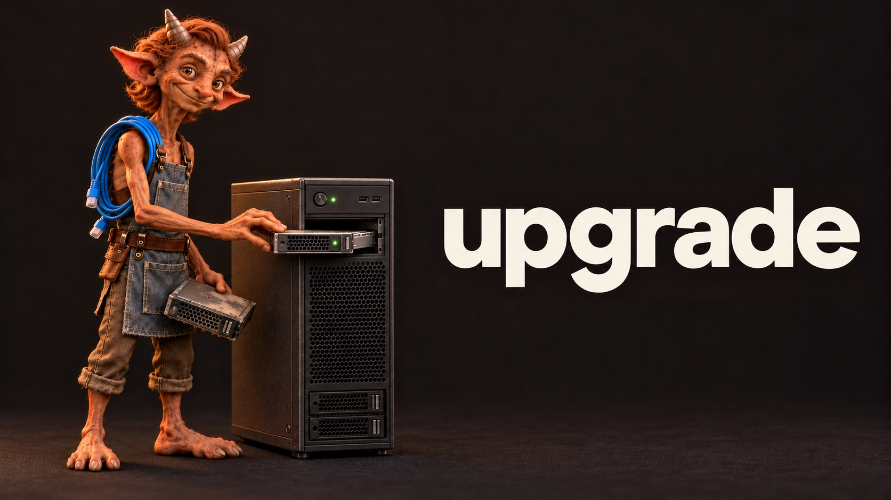

# Upgrading build-lab to 2.1

This covers both starting points, 2.0 and 1.0. Going from 1.0 is the same path with a few more things to read in step 5.

## Do you need to upgrade?

2.1 is a feature release, not a bug fix. On 2.0 and not after build profiles? On 1.0 and not after member servers or profiles? Then you may do better staying where you are until the next version. That one is planned to keep every setting you might change in a separate override file that upgrades leave alone, with a small script that moves the edits you have already made into it. Upgrading will be a lot less fiddly then.

If you do want 2.1 now, the steps below get you there without losing your settings or your labs.

## The versions that go together

| Project | Version | Why |
|---|---|---|
| build-lab | 2.1 | This release |
| new-AdDomain | 2.0 | build-lab 2.1 refuses 1.0 and stops before building anything |
| New-VMwareWorkstationVM | 1.0.2 | What 2.1 was tested with. build-lab does not check this one, and earlier releases are not tested with 2.1 |

## What an upgrade touches

Nothing gets installed and nothing gets migrated. Upgrading means replacing the three project folders and carrying your settings across. The VMs you already built are left alone, and a DC keeps the domain it was built with. That last part matters in step 4.

## Step 1. Find what you changed

build-lab takes its settings as parameters, not from a config file, so unless you edited a parameter default in `build-lab.ps1` there is nothing in its folder to save. The settings live in the two sibling projects. If you cloned the three, run these in the folder that holds them. They list every file you edited.

```powershell
git -C .\build-lab status
git -C .\new-AdDomain status
git -C .\New-VMwareWorkstationVM status
```

In new-AdDomain the usual suspects are `include\global-config.ps1` and the CSV files in `config\`. In New-VMwareWorkstationVM it is the defaults build-lab does not pass through, such as `-Edition`, `-TimeZone` and `-ProductKey`. Write down each value you changed.

If you never edited a file in any of the three, `git pull` in each folder is all it takes. Skip to step 4.

## Step 2. Get all three into fresh folders

Keep the old folders for reference. Run these in the folder that holds the three projects, so the new copies keep the sibling layout build-lab expects.

```powershell
Rename-Item -Path .\build-lab -NewName build-lab-old
Rename-Item -Path .\new-AdDomain -NewName new-AdDomain-old
Rename-Item -Path .\New-VMwareWorkstationVM -NewName New-VMwareWorkstationVM-old
git clone https://github.com/0x44616e69656c/build-lab.git
git clone https://github.com/0x44616e69656c/new-AdDomain.git
git clone https://github.com/0x44616e69656c/New-VMwareWorkstationVM.git
```

## Step 3. Put your settings back

**new-AdDomain.** Follow step 3 of [new-AdDomain's UPGRADE.md](https://github.com/0x44616e69656c/new-AdDomain/blob/main/UPGRADE.md). Domain identity goes in a build profile, everything else goes into the new global-config.ps1 by hand, and SPNs in `serviceaccounts.csv` get the `{DomainName}` placeholder. Don't copy your old global-config.ps1 over the new one. build-lab 2.1 refuses that copy with "is a new-AdDomain without build profile support". If you see that message after updating, an old global-config.ps1 is the reason, not an old new-AdDomain.

**New-VMwareWorkstationVM.** Make your default edits again in the new copy of `New-VMwareWorkstationVM.ps1`.

## Step 4. Your existing labs

A DC built by build-lab 1.0 or 2.0 is in `lab.local`, because that was new-AdDomain's default then. 2.1's default is `lab.test`, and that changes two things.

- **Adding or moving member servers.** `-AddMemberServers` and `-MoveMemberServers` against an older DC stop at the DC check, because it is not in `lab.test`. Save the profile below as a `.psd1` file and pass it with `-ProfilePath`. **Not tested.** The 2.1 live runs never ran either mode against a DC built before `lab.test`, from 1.0 or from 2.0. Of everything the DC check compares, only the domain changed in this upgrade, so the profile should be all it needs. Nobody has run it, though.
- **Full builds.** The same command line that gave you `lab.local` under 2.0 gives you `lab.test` under 2.1, with no warning. To keep building `lab.local`, pass the same profile to full builds as well. Expect a WARN that `.local` is reserved for multicast DNS.

```powershell
@{ DomainName = 'lab.local'; NetBIOSName = 'LAB' }
```

See [A DC built before lab.test](README.md#a-dc-built-before-labtest) in the README.

## Step 5. Scripts that call build-lab

No parameter has been removed or renamed since 1.0, so a command line that worked before still parses. 2.1 adds `-ProfilePath`. What a wrapper might notice is behavior.

**From 2.0.** The three items under [Breaking for 2.0 users](README.md#breaking-for-20-users). Two of them stop the run before anything is built. The third is the quiet `lab.test` change from step 4.

**From 1.0, as well.** Read [Changed behavior](README.md#changed-behavior-read-this-if-you-used-10). The changes most likely to trip a wrapper are these.

- A promotion that can't be verified now fails the run with exit code 1. 1.0 reported success after a fixed wait.
- Bad addresses and some passwords are refused before anything is built.
- `-SkipVmBuild` refuses a promoted DC and can't be combined with member servers. `-AddMemberServers` is the replacement for that case.

## Step 6. Do a first run

Do a full build under a new `-VmName` before you point 2.1 at a lab you care about. A bad profile or global-config.ps1 value stops the run before a VM exists. The first log line names the build-lab version that ran, so you can confirm you're on 2.1.

## What has been tested

2.1 was run end to end on live VMs in all four modes, with new-AdDomain 2.0 and New-VMwareWorkstationVM 1.0.2. I did not test the upgrade itself, carrying a modified older setup through these steps. These steps come from comparing the old and new files line by line, so treat them as a careful reading rather than a proven path, and tell me where they're wrong.
