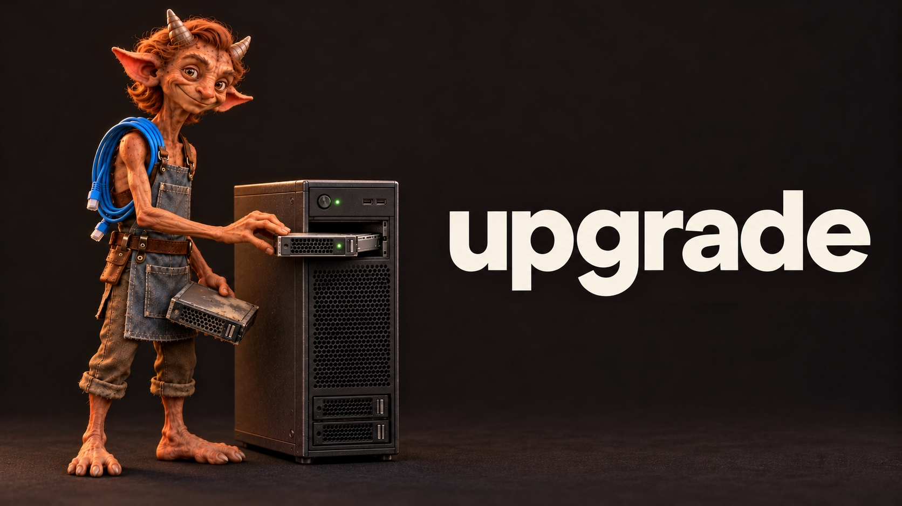

# Upgrading build-lab to 2.3

## From 2.2

Nothing needs moving. Your settings already live in the three `overrides` folders, so the upgrade is a `git pull` in each project folder, or fresh copies plus your `overrides` folders, as [Later upgrades](#later-upgrades) shows. Upgrade all three together. build-lab 2.3 needs new-AdDomain 2.2 and New-VMwareWorkstationVM 1.2, and an older new-AdDomain stops every run before a VM exists. An older VM builder gets a WARN.

Two things to do once.

- **Register the event source on each host.** build-lab no longer registers it. From an elevated PowerShell prompt in the build-lab folder:

  ```powershell
  .\Register-EventLogSource.ps1 -SourceName 'build-lab'
  ```

  Until you do, a run writes no events and logs one WARN that names the command. If you don't want build-lab's events at all, set `EnableEventLogging = $false` in `overrides\overrides.psd1` instead.
- **Update anything that filters on build-lab's event IDs.** They now follow a fixed map, and most of them changed.

  | Old ID | New ID | Meaning |
  |---|---|---|
  | 1000 | 1000 | Run started |
  | 1001 | 1001 | Run finished, now only when the run completed |
  | none | 1002 | Run stopped before it finished (Error) |
  | 1100, 1200, 1300, 1400, 1500, 1600, 1700 | 3000 | A step that worked. The message names the step |
  | none | 3000 | Directory population launched, and directory population finished |
  | 1650 | 9000 | A member server failed |
  | 9999 | 9000 | The run failed |

What's different once you're on 2.3.

- **Directory population runs without a logon.** A full build and `-SkipVmBuild` start it in the guest over vmrun and wait for it, so the run lasts until population finishes. You don't log into the DC anymore. Pass `-DeferPopulation`, or set `DeferPopulation = $true` in the override file, to keep the logon-triggered task and the red banner.
- **Members are built after population,** and a population that fails, never starts or runs past `-PopulationTimeoutMinutes` (240) fails the run before any member is built.
- **No automatic event source.** 2.2 registered the `build-lab` source when it ran elevated and fell back to the built-in `Application` source when it couldn't. 2.3 does neither, which is why the step above exists.
- **A second guest folder in `logs`** for a build that runs population, with its logs, its completion marker and its result files.
- **A wrapper that reads the log** may notice that event 1300's message, the "Directory population has NOT run yet" line, the red banner and the `-MoveMemberServers` stop for a missing `OU=Servers` changed. The first three now depend on `-DeferPopulation`. The stop for an older sibling, the member cap stop and the add run's DC mismatch stop are worded differently too, and the add and move runs' vmrun errors name the DC read `query machine identity`, not `query DC identity`.
- **new-AdDomain's build profile messages are reworded,** and build-lab shows them when it checks your profile. That covers the WARN for an empty `BuildName`, `CertificateAuthority`, `Machines` or `Trusts`, the stop for one with a value, and the "did you mean" hint. new-AdDomain's [What's New in 2.2](https://github.com/0x44616e69656c/new-AdDomain/blob/main/README.md#whats-new-in-22) quotes the new lines.
- **An override `MemberServerCount` no longer stops** a `-MoveMemberServers` or `-SkipVmBuild` run, as it did in 2.2. Those runs leave it unused and log one INFO line, or a WARN when a full build would refuse the value.
- **The guest-ready wait can end sooner**, because it tries the guest while VMware Tools still reports `installed`. Anything that times a build may see that wait end at a different point.
- **An example override file.** `examples\overrides.psd1` lists every setting, commented out at its shipped value. Copy it into `overrides\` to start a file of your own. If you're moving edits from an older copy with `Export-OverrideFile.ps1`, run that first. It writes to a separate folder when `overrides\overrides.psd1` already exists.
- **A network check before anything is built.** A full build and `-AddMemberServers` look at your host's adapters and its route to the DC first. They stop when the VMs couldn't answer your host, which before 2.3 cost the VM builder's whole timeout and then failed anyway. A second adapter on the same subnet is a WARN, and so is a host that won't let build-lab read its adapters.
- **A mask you never set follows the host adapter.** Without `-SubnetMask` and without `SubnetMask` in the override file, the VMs take the prefix of the network's host adapter. NAT is still a /24.
- **`-AddMemberServers` uses the DC's own network**, read from its VMX, and warns when you asked for another.
- **Hidden files the guest uses stop a run.** The payload zip can't carry them. A hidden `.ps1`, `.psd1`, `.csv` or `.json` in new-AdDomain, or one in a hidden folder there, is named and the run stops before any VM exists. `attrib -h` on the file or folder clears it. Other hidden files, such as `desktop.ini`, get a WARN and are left out.
- **A gateway in New-VMwareWorkstationVM's override file is now checked** when you don't pass `-DefaultGateway`. The VMs get it as before, with a WARN that says so, and a gateway outside the DC's subnet stops the run.
- **Two more files in `logs`.** Every run writes a build manifest, `build-lab-manifest_<timestamp>.csv`, and the first build against an ISO hashes it into `iso-sha256-cache.csv`, which costs from a few seconds to a minute or more, once per ISO. [The build manifest](README.md#the-build-manifest) says what it holds.
- **Custom VMnets are new.** `-NetworkType VMnet2` and up, a build profile's `NetworkType` and the override file all take one. Nothing you set before changes meaning, because `nat`, `bridged` and `hostonly` behave as they did.

2.3 changes none of build-lab's shipped defaults, so your first run logs no changed-default line from build-lab.

Three known bugs ship with 2.3. A rerun to the same address can stop with a false route error, an interrupted run can leave the answer ISO in `%TEMP%` without saying so, and a population timeout leaves its logs in the guest. Each has a workaround in [Known Issues](README.md#known-issues).

For everything new, see [What's New in 2.3](README.md#whats-new-in-23) in the README.

## From 2.1, 2.0 or 1.0

Follow [Upgrading build-lab to 2.2](#upgrading-build-lab-to-22) below with 2.3 copies of all three projects. The steps are the same, and everything in [From 2.2](#from-22) applies as well.

# Upgrading build-lab to 2.2

**Tested live on 2026-11-11.** Edited 2.0 and 2.1 setups, each with edited copies of the two siblings, went through these steps, and each new set of folders then built a lab with the settings it carried across. The migration has run against 1.0 in the offline tests only. Keep your old folders until the new ones have built a lab for you, and tell me where these steps are wrong.

This covers all three starting points, 2.1, 2.0 and 1.0. The path is the same for each. Coming from 2.0 or 1.0 just means more to read in step 6.

## What an upgrade touches

Nothing gets installed. Upgrading means replacing the three project folders and carrying your settings across. The VMs you already built are left alone, and a DC keeps the domain it was built with.

Up to 2.1 your settings lived in tracked files, mostly new-AdDomain's `include\global-config.ps1` and its CSV files, and the parameter defaults in `build-lab.ps1` and `New-VMwareWorkstationVM.ps1`. From 2.2 they live in an `overrides` folder in each project, which git ignores and no upgrade touches. Each project ships an `Export-OverrideFile.ps1` that reads your old copy without running it and writes what you changed into that folder. This is the last upgrade that needs your edits moved.

[OVERRIDE.md](OVERRIDE.md) lists every setting build-lab's override file can hold. new-AdDomain and New-VMwareWorkstationVM each have their own.

## The versions that go together

| Project | Version | Why |
|---|---|---|
| build-lab | 2.2 | This release |
| new-AdDomain | 2.1 | build-lab 2.2 checks its version and stops on an older one before building anything |
| New-VMwareWorkstationVM | 1.1 | build-lab 2.2 checks its version too. An older one gets a WARN, and stops the run only when it has an override file it would ignore |

## Never edited a file?

If you never changed a file in any of the three projects, there is nothing to move. In the folder that holds them:

```powershell
git -C .\build-lab pull
git -C .\new-AdDomain pull
git -C .\New-VMwareWorkstationVM pull
```

Not sure? These list every file you changed in a clone:

```powershell
git -C .\build-lab status
git -C .\new-AdDomain status
git -C .\New-VMwareWorkstationVM status
```

Nothing listed in any of them means `git pull` was all it took. Skip to step 7.

## Step 1. Keep the old folders and get fresh copies

Run these in the folder that holds the three projects, so the new copies keep the sibling layout build-lab expects.

```powershell
Rename-Item -Path .\build-lab -NewName build-lab-old
Rename-Item -Path .\new-AdDomain -NewName new-AdDomain-old
Rename-Item -Path .\New-VMwareWorkstationVM -NewName New-VMwareWorkstationVM-old
git clone https://github.com/0x44616e69656c/build-lab.git
git clone https://github.com/0x44616e69656c/new-AdDomain.git
git clone https://github.com/0x44616e69656c/New-VMwareWorkstationVM.git
```

Downloaded zips instead? Extract each one to a folder with the project's name, next to its `-old` folder, look the files over, then unblock them:

```powershell
Get-ChildItem -Path .\build-lab, .\new-AdDomain, .\New-VMwareWorkstationVM -Recurse -File | Unblock-File
```

## Step 2. Move build-lab's edits

The migration reads `build-lab-old` and never runs anything in it. With `-WhatIf` it writes nothing except its log.

```powershell
cd .\build-lab
.\Export-OverrideFile.ps1 -SourcePath ..\build-lab-old -WhatIf
```

Its log, `logs\Export-OverrideFile_<timestamp>.csv`, has one row per setting with what it found and why. If it looks right, run it for real and read the result:

```powershell
.\Export-OverrideFile.ps1 -SourcePath ..\build-lab-old
Get-Content .\overrides\overrides.psd1
cd ..
```

What it does with each kind of setting:

- **A default you changed** in `build-lab.ps1`, such as `-RamMB` or the member server cap, is written to `overrides\overrides.psd1`, with a comment naming the line it came from
- **A default you never changed** is left out, so the shipped value applies and later releases can improve it
- **A value 2.2 would refuse** is written commented out with the reason. Fix it and remove the `#`
- **A value worked out at run time** can't be read without running the script, so it's listed for you to set by hand
- **A relative `-AdDomainSourcePath` or `-VmBuilderScriptPath` default** is written with a WARN. In the override file a relative path resolves from build-lab's folder, not from wherever you started the run, so check it still points where you meant
- **An existing override file** is never overwritten. The new one goes to `overrides\migrated-<date>-<time>\` for you to merge by hand

build-lab 1.0 had no member server settings, so a 1.0 copy just has fewer rows.

## Step 3. Move the two siblings' edits

Each sibling ships its own migration script, and works the same way. new-AdDomain's is the one that matters most, because that is where the domain, the password policy and the CSV files live.

```powershell
cd .\new-AdDomain
.\Export-OverrideFile.ps1 -SourcePath ..\new-AdDomain-old -WhatIf
.\Export-OverrideFile.ps1 -SourcePath ..\new-AdDomain-old
cd ..
cd .\New-VMwareWorkstationVM
.\Export-OverrideFile.ps1 -SourcePath ..\New-VMwareWorkstationVM-old -WhatIf
.\Export-OverrideFile.ps1 -SourcePath ..\New-VMwareWorkstationVM-old
cd ..
```

new-AdDomain's script also reports defaults that changed since your release, such as `lab.local` becoming `lab.test`, and writes them only with `-KeepPreviousDefaults`. Its [UPGRADE.md](https://github.com/0x44616e69656c/new-AdDomain/blob/main/UPGRADE.md) explains which ones and when you want the switch. The builder's [UPGRADE.md](https://github.com/0x44616e69656c/New-VMwareWorkstationVM/blob/main/UPGRADE.md) covers its image names and answer file settings.

Don't copy an old `include\global-config.ps1` over the new one. build-lab 2.2 checks its version and stops with a message saying an older copy was put back.

## Step 4. Bring your build profile

A build profile was never tracked by git, so copy it across if you keep one in new-AdDomain's folder:

```powershell
Copy-Item -Path .\new-AdDomain-old\include\build-profile.psd1 -Destination .\new-AdDomain\include\build-profile.psd1
```

Skip this if `.\new-AdDomain-old\include\build-profile.psd1` doesn't exist. Profiles you keep elsewhere and pass with `-ProfilePath` need nothing.

## Step 5. Your existing labs

A DC built by build-lab 1.0 or 2.0 is in `lab.local`, because that was new-AdDomain's default then. 2.2 handles it in two ways.

- **Adding or moving member servers.** When nothing names a domain (no profile, no override file and no edit to `global-config.ps1`), `-AddMemberServers` and `-MoveMemberServers` read the DC's own domain from the DC and use it, with a WARN that names both domains. The `lab.local` profile 2.1 needed still works, so keep passing it if you already do. **Tested live on 2026-11-11**, adding a member to a `lab.local` DC built by 2.0 and then moving it, with nothing naming the domain.
- **Full builds.** A full build with nothing naming a domain gives `lab.test`. To keep building `lab.local`, add these two lines to new-AdDomain's `overrides\overrides.psd1`, inside its `@{ }`, or keep passing the profile. Expect a WARN that `.local` is reserved for multicast DNS.

```powershell
    DomainName = 'lab.local'
    NetBIOSName = 'LAB'
```

Once a domain is named, the add and move runs check the DC against it again, so a DC in `lab.test` would then need its own profile.

## Step 6. Scripts that call build-lab

No parameter has been removed or renamed since 1.0, so a command line that worked before still parses. 2.2 adds no parameter. What a wrapper might notice is behavior.

**From 2.1.**

- An override file with a typo, an unknown key or a bad value stops the run before anything is built, with exit code 1. No file at all is one INFO line.
- An older new-AdDomain, or an older `global-config.ps1`, stops the run before anything is built.
- Member work against a `lab.local` DC goes ahead with a WARN where 2.1 stopped.

**From 2.0, as well.** The three items under [Breaking for 2.0 users](README.md#breaking-for-20-users). The second no longer applies, as step 5 says.

**From 1.0, as well.** Read [Changed behavior](README.md#changed-behavior-read-this-if-you-used-10). The changes most likely to trip a wrapper are these.

- A promotion that can't be verified now fails the run with exit code 1. 1.0 reported success after a fixed wait.
- Bad addresses and some passwords are refused before anything is built.
- `-SkipVmBuild` refuses a promoted DC and can't be combined with member servers. `-AddMemberServers` is the replacement for that case.

## Step 7. Do a first run

Do a full build under a new `-VmName` before you point 2.2 at a lab you care about. The first log line names the build-lab version that ran. The lines after it name the override file with its SHA-256 and every setting it applied, and the version of each sibling, so the first run doubles as the check that your settings came across. Each project also logs one INFO line for any shipped default that changed since its last release and that your run didn't set, naming the override key that keeps the old value. build-lab 2.2 changes none of its own. A bad value stops the run before a VM exists. When that build looks right, the `-old` folders can go.

## Later upgrades

From 2.2 on, keep every change in the three `overrides` folders and your build profiles. A clone then upgrades with `git pull` in each folder, as in "Never edited a file?" above. From zips, get the new releases into fresh folders as in step 1, then copy the three `overrides` folders across:

```powershell
Copy-Item -Path .\build-lab-old\overrides -Destination .\build-lab -Recurse
Copy-Item -Path .\new-AdDomain-old\overrides -Destination .\new-AdDomain -Recurse
Copy-Item -Path .\New-VMwareWorkstationVM-old\overrides -Destination .\New-VMwareWorkstationVM -Recurse
```

A project with no `overrides` folder gives an error for that line, which you can ignore. Nothing else carries over.

## What has been tested

The migration was run offline against unedited copies of build-lab 1.0, 2.0 and 2.1 taken from their release tags, and against copies with edited defaults, values it should refuse and a file already in `overrides`. On 2026-11-11 edited 2.0 and 2.1 setups went through these steps on live VMs, and each migrated setup then built a lab. The `lab.local` DC that the 2.0 setup had built also took an added member and a move, with nothing naming its domain. 1.0 has been through the migration offline only. 2.1 itself was run end to end on live VMs in all four modes, with new-AdDomain 2.0 and New-VMwareWorkstationVM 1.0.2.
